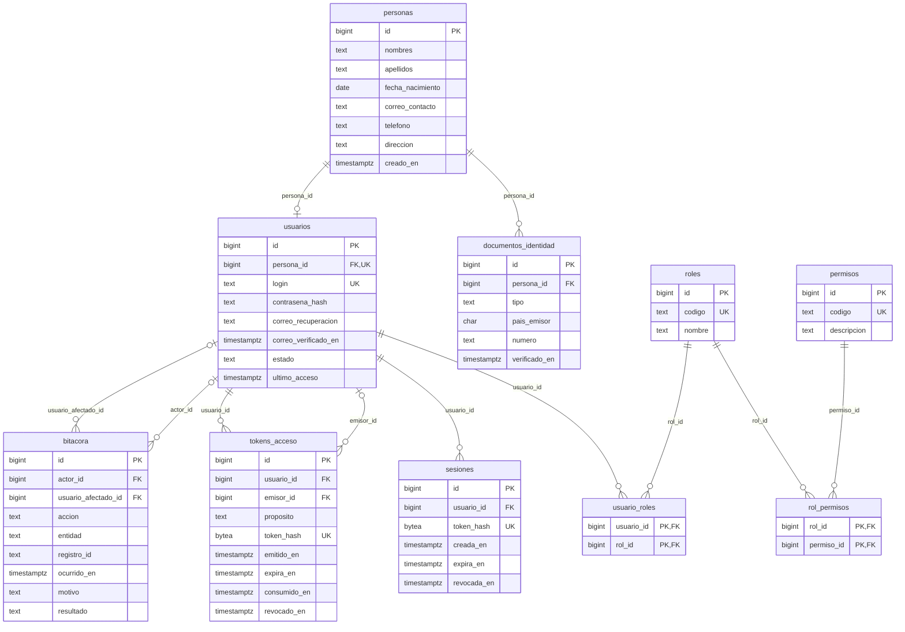

<!-- Archivo generado por scripts/db/generar-docs.mjs a partir del catálogo real. No editar a mano. -->

# Identidad, permisos y auditoría

Tablas (10): [`personas`](#personas), [`documentos_identidad`](#documentos_identidad), [`usuarios`](#usuarios), [`roles`](#roles), [`permisos`](#permisos), [`rol_permisos`](#rol_permisos), [`usuario_roles`](#usuario_roles), [`sesiones`](#sesiones), [`tokens_acceso`](#tokens_acceso), [`bitacora`](#bitacora).

## Diagrama ER

> Para legibilidad se omiten las referencias de auditoría/evidencia hacia `usuarios` y `archivos` cuando esas tablas no pertenecen al diagrama; sí figuran en el diccionario.

## Diccionario

### personas

Persona física única (alumno, apoderado, docente o usuario). Nombres, apellidos y contacto.

| Columna | Tipo | Nulo | Defecto / generada | Clave / referencia |
|---|---|---|---|---|
| `id` | bigint | no | identity (always) | PK |
| `nombres` | text | no |  |  |
| `apellidos` | text | no |  |  |
| `fecha_nacimiento` | date | sí |  |  |
| `correo_contacto` | text | sí |  |  |
| `telefono` | text | sí |  |  |
| `direccion` | text | sí |  |  |
| `creado_en` | timestamptz | no | `now()` |  |

**Restricciones**

- **PK** (id)
- **CHECK** `personas_apellidos_check`: `((btrim(apellidos) <> ''))`
- **CHECK** `personas_nombres_check`: `((btrim(nombres) <> ''))`

### documentos_identidad

Documentos de identidad de una persona. DNI exige país PE y 8 dígitos; número normalizado en mayúsculas.

| Columna | Tipo | Nulo | Defecto / generada | Clave / referencia |
|---|---|---|---|---|
| `id` | bigint | no | identity (always) | PK |
| `persona_id` | bigint | no |  | → [`personas`](01-identidad-permisos.md#personas).id |
| `tipo` | text | no |  |  |
| `pais_emisor` | character(2) | no | `'PE'` |  |
| `numero` | text | no |  |  |
| `verificado_en` | timestamptz | sí |  |  |

**Restricciones**

- **PK** (id)
- **UNIQUE** (tipo, pais_emisor, numero) — `documentos_identidad_tipo_pais_emisor_numero_key`
- **CHECK** `documentos_identidad_check`: `(((tipo <> 'DNI') OR ((pais_emisor = 'PE') AND (numero ~ '^[0-9]{8}$'))))`
- **CHECK** `documentos_identidad_numero_check`: `(((numero = upper(btrim(numero))) AND (numero <> '')))`

**Índices adicionales**

- `documentos_identidad_persona_idx`: `USING btree (persona_id)`

### usuarios

Cuenta de acceso 1:1 con una persona. Login normalizado en minúsculas; estado pendiente/activo/suspendido; "activo" exige contrasena_hash.

| Columna | Tipo | Nulo | Defecto / generada | Clave / referencia |
|---|---|---|---|---|
| `id` | bigint | no | identity (always) | PK |
| `persona_id` | bigint | no |  | → [`personas`](01-identidad-permisos.md#personas).id · UNIQUE |
| `login` | text | no |  | UNIQUE |
| `contrasena_hash` | text | sí |  |  |
| `correo_recuperacion` | text | sí |  |  |
| `correo_verificado_en` | timestamptz | sí |  |  |
| `estado` | text | no | `'pendiente'` |  |
| `ultimo_acceso` | timestamptz | sí |  |  |

**Restricciones**

- **PK** (id)
- **UNIQUE** (login) — `usuarios_login_key`
- **UNIQUE** (persona_id) — `usuarios_persona_id_key`
- **CHECK** `usuarios_check`: `(((estado <> 'activo') OR (NULLIF(btrim(contrasena_hash), '') IS NOT NULL)))`
- **CHECK** `usuarios_check1`: `(((correo_verificado_en IS NULL) OR (correo_recuperacion IS NOT NULL)))`
- **CHECK** `usuarios_estado_check`: `((estado = ANY (ARRAY['pendiente', 'activo', 'suspendido'])))`
- **CHECK** `usuarios_login_check`: `(((login = lower(btrim(login))) AND (login <> '')))`

### roles

Catálogo de roles: admin, docente, alumno, apoderado.

Filas sembradas en el dump: **4**.

| Columna | Tipo | Nulo | Defecto / generada | Clave / referencia |
|---|---|---|---|---|
| `id` | bigint | no | identity (always) | PK |
| `codigo` | text | no |  | UNIQUE |
| `nombre` | text | no |  |  |

**Restricciones**

- **PK** (id)
- **UNIQUE** (codigo) — `roles_codigo_key`

### permisos

Catálogo de permisos atómicos (dominio.accion). La app autoriza por permiso, no por rol.

Filas sembradas en el dump: **32**.

| Columna | Tipo | Nulo | Defecto / generada | Clave / referencia |
|---|---|---|---|---|
| `id` | bigint | no | identity (always) | PK |
| `codigo` | text | no |  | UNIQUE |
| `descripcion` | text | no |  |  |

**Restricciones**

- **PK** (id)
- **UNIQUE** (codigo) — `permisos_codigo_key`

### rol_permisos

Permisos otorgados a cada rol.

Filas sembradas en el dump: **37**.

| Columna | Tipo | Nulo | Defecto / generada | Clave / referencia |
|---|---|---|---|---|
| `rol_id` | bigint | no |  | PK · → [`roles`](01-identidad-permisos.md#roles).id |
| `permiso_id` | bigint | no |  | PK · → [`permisos`](01-identidad-permisos.md#permisos).id |

**Restricciones**

- **PK** (rol_id, permiso_id)

### usuario_roles

Roles de cada usuario (un usuario puede tener varios).

| Columna | Tipo | Nulo | Defecto / generada | Clave / referencia |
|---|---|---|---|---|
| `usuario_id` | bigint | no |  | PK · → [`usuarios`](01-identidad-permisos.md#usuarios).id |
| `rol_id` | bigint | no |  | PK · → [`roles`](01-identidad-permisos.md#roles).id |

**Restricciones**

- **PK** (usuario_id, rol_id)

### sesiones

Sesiones web. Solo se guarda el hash del token; expiración y revocación.

| Columna | Tipo | Nulo | Defecto / generada | Clave / referencia |
|---|---|---|---|---|
| `id` | bigint | no | identity (always) | PK |
| `usuario_id` | bigint | no |  | → [`usuarios`](01-identidad-permisos.md#usuarios).id |
| `token_hash` | bytea | no |  | UNIQUE |
| `creada_en` | timestamptz | no | `now()` |  |
| `expira_en` | timestamptz | no |  |  |
| `revocada_en` | timestamptz | sí |  |  |

**Restricciones**

- **PK** (id)
- **UNIQUE** (token_hash) — `sesiones_token_hash_key`
- **CHECK** `sesiones_check`: `((expira_en > creada_en))`

**Índices adicionales**

- `sesiones_usuario_idx`: `USING btree (usuario_id)`

### tokens_acceso

Tokens de un solo uso para activación (primer ingreso) y recuperación: hash, expiración, consumo y revocación.

| Columna | Tipo | Nulo | Defecto / generada | Clave / referencia |
|---|---|---|---|---|
| `id` | bigint | no | identity (always) | PK |
| `usuario_id` | bigint | no |  | → [`usuarios`](01-identidad-permisos.md#usuarios).id |
| `emisor_id` | bigint | sí |  | → [`usuarios`](01-identidad-permisos.md#usuarios).id |
| `proposito` | text | no |  |  |
| `token_hash` | bytea | no |  | UNIQUE |
| `emitido_en` | timestamptz | no | `now()` |  |
| `expira_en` | timestamptz | no |  |  |
| `consumido_en` | timestamptz | sí |  |  |
| `revocado_en` | timestamptz | sí |  |  |

**Restricciones**

- **PK** (id)
- **UNIQUE** (token_hash) — `tokens_acceso_token_hash_key`
- **CHECK** `tokens_acceso_check`: `((expira_en > emitido_en))`
- **CHECK** `tokens_acceso_check1`: `(((consumido_en IS NULL) OR (consumido_en >= emitido_en)))`
- **CHECK** `tokens_acceso_proposito_check`: `((proposito = ANY (ARRAY['activacion', 'recuperacion'])))`

**Índices adicionales**

- `tokens_acceso_usuario_idx`: `USING btree (usuario_id)`

### bitacora

Auditoría: actor, usuario afectado, acción, entidad, registro, motivo y resultado. También la escriben los triggers.

| Columna | Tipo | Nulo | Defecto / generada | Clave / referencia |
|---|---|---|---|---|
| `id` | bigint | no | identity (always) | PK |
| `actor_id` | bigint | sí |  | → [`usuarios`](01-identidad-permisos.md#usuarios).id |
| `usuario_afectado_id` | bigint | sí |  | → [`usuarios`](01-identidad-permisos.md#usuarios).id |
| `accion` | text | no |  |  |
| `entidad` | text | no |  |  |
| `registro_id` | text | sí |  |  |
| `ocurrido_en` | timestamptz | no | `now()` |  |
| `motivo` | text | sí |  |  |
| `resultado` | text | no |  |  |

**Restricciones**

- **PK** (id)
