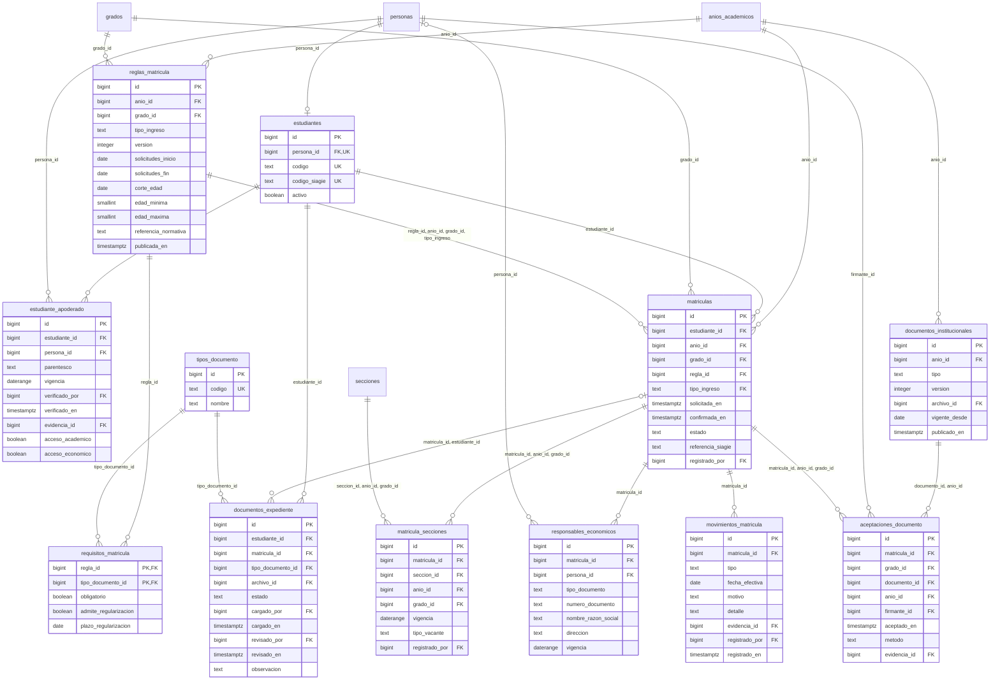

<!-- Archivo generado por scripts/db/generar-docs.mjs a partir del catálogo real. No editar a mano. -->

# Matrícula, familia y expediente

Tablas (12): [`estudiantes`](#estudiantes), [`estudiante_apoderado`](#estudiante_apoderado), [`reglas_matricula`](#reglas_matricula), [`requisitos_matricula`](#requisitos_matricula), [`tipos_documento`](#tipos_documento), [`matriculas`](#matriculas), [`matricula_secciones`](#matricula_secciones), [`movimientos_matricula`](#movimientos_matricula), [`documentos_expediente`](#documentos_expediente), [`responsables_economicos`](#responsables_economicos), [`documentos_institucionales`](#documentos_institucionales), [`aceptaciones_documento`](#aceptaciones_documento).

## Diagrama ER

> Para legibilidad se omiten las referencias de auditoría/evidencia hacia `usuarios` y `archivos` cuando esas tablas no pertenecen al diagrama; sí figuran en el diccionario.

## Diccionario

### estudiantes

Perfil de alumno de una persona: código interno único, código SIAGIE único (opcional) y estado activo.

| Columna | Tipo | Nulo | Defecto / generada | Clave / referencia |
|---|---|---|---|---|
| `id` | bigint | no | identity (always) | PK |
| `persona_id` | bigint | no |  | → [`personas`](01-identidad-permisos.md#personas).id · UNIQUE |
| `codigo` | text | no |  | UNIQUE |
| `codigo_siagie` | text | sí |  | UNIQUE |
| `activo` | boolean | no | `true` |  |

**Restricciones**

- **PK** (id)
- **UNIQUE** (codigo) — `estudiantes_codigo_key`
- **UNIQUE** (codigo_siagie) — `estudiantes_codigo_siagie_key`
- **UNIQUE** (persona_id) — `estudiantes_persona_id_key`

### estudiante_apoderado

Vínculo alumno–apoderado con parentesco y vigencia sin solapes. acceso_academico/acceso_economico solo si el vínculo fue verificado.

| Columna | Tipo | Nulo | Defecto / generada | Clave / referencia |
|---|---|---|---|---|
| `id` | bigint | no | identity (always) | PK |
| `estudiante_id` | bigint | no |  | → [`estudiantes`](02-matricula.md#estudiantes).id |
| `persona_id` | bigint | no |  | → [`personas`](01-identidad-permisos.md#personas).id |
| `parentesco` | text | no |  |  |
| `vigencia` | daterange | no |  |  |
| `verificado_por` | bigint | sí |  | → [`usuarios`](01-identidad-permisos.md#usuarios).id |
| `verificado_en` | timestamptz | sí |  |  |
| `evidencia_id` | bigint | sí |  | → [`archivos`](07-documentos-reportes.md#archivos).id |
| `acceso_academico` | boolean | no | `false` |  |
| `acceso_economico` | boolean | no | `false` |  |

**Restricciones**

- **PK** (id)
- **CHECK** `estudiante_apoderado_check`: `(((NOT (acceso_academico OR acceso_economico)) OR ((verificado_por IS NOT NULL) AND (verificado_en IS NOT NULL))))`
- **CHECK** `estudiante_apoderado_vigencia_check`: `(((NOT isempty(vigencia)) AND (NOT lower_inf(vigencia))))`
- **EXCLUDE** `estudiante_apoderado_estudiante_id_persona_id_vigencia_excl`: `USING gist (estudiante_id WITH =, persona_id WITH =, vigencia WITH &&)`

**Índices adicionales**

- `estudiante_apoderado_persona_idx`: `USING btree (persona_id)`

### reglas_matricula

Reglas versionadas por año, grado y tipo de ingreso (nuevo, continuidad, traslado): ventana de solicitudes, edad y referencia normativa.

| Columna | Tipo | Nulo | Defecto / generada | Clave / referencia |
|---|---|---|---|---|
| `id` | bigint | no | identity (always) | PK |
| `anio_id` | bigint | no |  | → [`anios_academicos`](03-academico-evaluacion.md#anios_academicos).id |
| `grado_id` | bigint | no |  | → [`grados`](03-academico-evaluacion.md#grados).id |
| `tipo_ingreso` | text | no |  |  |
| `version` | integer | no |  |  |
| `solicitudes_inicio` | date | no |  |  |
| `solicitudes_fin` | date | no |  |  |
| `corte_edad` | date | sí |  |  |
| `edad_minima` | smallint | sí |  |  |
| `edad_maxima` | smallint | sí |  |  |
| `referencia_normativa` | text | sí |  |  |
| `publicada_en` | timestamptz | sí |  |  |

**Restricciones**

- **PK** (id)
- **UNIQUE** (anio_id, grado_id, tipo_ingreso, version) — `reglas_matricula_anio_id_grado_id_tipo_ingreso_version_key`
- **UNIQUE** (id, anio_id, grado_id, tipo_ingreso) — `reglas_matricula_id_anio_id_grado_id_tipo_ingreso_key`
- **CHECK** `reglas_matricula_check`: `(((edad_maxima >= edad_minima) AND (edad_maxima >= 0)))`
- **CHECK** `reglas_matricula_check1`: `((solicitudes_fin >= solicitudes_inicio))`
- **CHECK** `reglas_matricula_check2`: `((((edad_minima IS NULL) AND (edad_maxima IS NULL)) OR (corte_edad IS NOT NULL)))`
- **CHECK** `reglas_matricula_edad_minima_check`: `((edad_minima >= 0))`
- **CHECK** `reglas_matricula_tipo_ingreso_check`: `((tipo_ingreso = ANY (ARRAY['nuevo', 'continuidad', 'traslado'])))`
- **CHECK** `reglas_matricula_version_check`: `((version > 0))`

### requisitos_matricula

Documentos exigidos por una regla de matrícula, obligatoriedad y plazo de regularización.

| Columna | Tipo | Nulo | Defecto / generada | Clave / referencia |
|---|---|---|---|---|
| `regla_id` | bigint | no |  | PK · → [`reglas_matricula`](02-matricula.md#reglas_matricula).id |
| `tipo_documento_id` | bigint | no |  | PK · → [`tipos_documento`](02-matricula.md#tipos_documento).id |
| `obligatorio` | boolean | no | `true` |  |
| `admite_regularizacion` | boolean | no | `false` |  |
| `plazo_regularizacion` | date | sí |  |  |

**Restricciones**

- **PK** (regla_id, tipo_documento_id)
- **CHECK** `requisitos_matricula_check`: `(((plazo_regularizacion IS NULL) OR admite_regularizacion))`

### tipos_documento

Catálogo de tipos de documento del expediente (sin semillas).

| Columna | Tipo | Nulo | Defecto / generada | Clave / referencia |
|---|---|---|---|---|
| `id` | bigint | no | identity (always) | PK |
| `codigo` | text | no |  | UNIQUE |
| `nombre` | text | no |  |  |

**Restricciones**

- **PK** (id)
- **UNIQUE** (codigo) — `tipos_documento_codigo_key`

### matriculas

Matrícula anual (una por alumno y año). Estados: solicitada → activa → retirada/trasladada; o anulada. Activa/retirada/trasladada exigen confirmada_en.

| Columna | Tipo | Nulo | Defecto / generada | Clave / referencia |
|---|---|---|---|---|
| `id` | bigint | no | identity (always) | PK |
| `estudiante_id` | bigint | no |  | → [`estudiantes`](02-matricula.md#estudiantes).id |
| `anio_id` | bigint | no |  | → [`anios_academicos`](03-academico-evaluacion.md#anios_academicos).id · → [`reglas_matricula`](02-matricula.md#reglas_matricula) (FK compuesta) |
| `grado_id` | bigint | no |  | → [`grados`](03-academico-evaluacion.md#grados).id · → [`reglas_matricula`](02-matricula.md#reglas_matricula) (FK compuesta) |
| `regla_id` | bigint | no |  | → [`reglas_matricula`](02-matricula.md#reglas_matricula) (FK compuesta) |
| `tipo_ingreso` | text | no |  | → [`reglas_matricula`](02-matricula.md#reglas_matricula) (FK compuesta) |
| `solicitada_en` | timestamptz | no | `now()` |  |
| `confirmada_en` | timestamptz | sí |  |  |
| `estado` | text | no | `'solicitada'` |  |
| `referencia_siagie` | text | sí |  |  |
| `registrado_por` | bigint | no |  | → [`usuarios`](01-identidad-permisos.md#usuarios).id |

**Restricciones**

- **PK** (id)
- **UNIQUE** (estudiante_id, anio_id) — `matriculas_estudiante_id_anio_id_key`
- **UNIQUE** (id, anio_id, grado_id) — `matriculas_id_anio_id_grado_id_key`
- **UNIQUE** (id, estudiante_id) — `matriculas_id_estudiante_id_key`
- **FK** (regla_id, anio_id, grado_id, tipo_ingreso) → [`reglas_matricula`](02-matricula.md#reglas_matricula) (id, anio_id, grado_id, tipo_ingreso)
- **CHECK** `matriculas_check`: `(((estado <> ALL (ARRAY['activa', 'retirada', 'trasladada'])) OR (confirmada_en IS NOT NULL)))`
- **CHECK** `matriculas_check1`: `((confirmada_en >= solicitada_en))`
- **CHECK** `matriculas_estado_check`: `((estado = ANY (ARRAY['solicitada', 'activa', 'retirada', 'trasladada', 'anulada'])))`

**Índices adicionales**

- `matriculas_anio_grado_idx`: `USING btree (anio_id, grado_id, estado)`

### matricula_secciones

Ubicación del alumno en una sección con vigencia acotada (sin solapes por matrícula) y tipo de vacante; controla cupos.

| Columna | Tipo | Nulo | Defecto / generada | Clave / referencia |
|---|---|---|---|---|
| `id` | bigint | no | identity (always) | PK |
| `matricula_id` | bigint | no |  | → [`matriculas`](02-matricula.md#matriculas) (FK compuesta) |
| `seccion_id` | bigint | no |  | → [`secciones`](03-academico-evaluacion.md#secciones) (FK compuesta) |
| `anio_id` | bigint | no |  | → [`matriculas`](02-matricula.md#matriculas) (FK compuesta) · → [`secciones`](03-academico-evaluacion.md#secciones) (FK compuesta) |
| `grado_id` | bigint | no |  | → [`matriculas`](02-matricula.md#matriculas) (FK compuesta) · → [`secciones`](03-academico-evaluacion.md#secciones) (FK compuesta) |
| `vigencia` | daterange | no |  |  |
| `tipo_vacante` | text | no | `'regular'` |  |
| `registrado_por` | bigint | no |  | → [`usuarios`](01-identidad-permisos.md#usuarios).id |

**Restricciones**

- **PK** (id)
- **FK** (matricula_id, anio_id, grado_id) → [`matriculas`](02-matricula.md#matriculas) (id, anio_id, grado_id)
- **FK** (seccion_id, anio_id, grado_id) → [`secciones`](03-academico-evaluacion.md#secciones) (id, anio_id, grado_id)
- **CHECK** `matricula_secciones_tipo_vacante_check`: `((tipo_vacante = ANY (ARRAY['regular', 'reservada'])))`
- **CHECK** `matricula_secciones_vigencia_check`: `(((NOT isempty(vigencia)) AND (NOT lower_inf(vigencia)) AND (NOT upper_inf(vigencia))))`
- **EXCLUDE** `matricula_secciones_matricula_id_vigencia_excl`: `USING gist (matricula_id WITH =, vigencia WITH &&)`

**Índices adicionales**

- `matricula_secciones_ocupacion_idx`: `USING gist (seccion_id, vigencia)`

**Triggers**

- `controlar_cupo` — BEFORE INSERT OR UPDATE OF seccion_id, anio_id, vigencia, tipo_vacante → [`validar_ocupacion_seccion()`](../funciones.md#validar_ocupacion_seccion)

### movimientos_matricula

Historial de movimientos: confirmación, cambio de sección, traslado, retiro, reincorporación, anulación. Sin trigger: la app debe registrarlo.

| Columna | Tipo | Nulo | Defecto / generada | Clave / referencia |
|---|---|---|---|---|
| `id` | bigint | no | identity (always) | PK |
| `matricula_id` | bigint | no |  | → [`matriculas`](02-matricula.md#matriculas).id |
| `tipo` | text | no |  |  |
| `fecha_efectiva` | date | no |  |  |
| `motivo` | text | no |  |  |
| `detalle` | text | sí |  |  |
| `evidencia_id` | bigint | sí |  | → [`archivos`](07-documentos-reportes.md#archivos).id |
| `registrado_por` | bigint | no |  | → [`usuarios`](01-identidad-permisos.md#usuarios).id |
| `registrado_en` | timestamptz | no | `now()` |  |

**Restricciones**

- **PK** (id)
- **CHECK** `movimientos_matricula_tipo_check`: `((tipo = ANY (ARRAY['confirmacion', 'cambio_seccion', 'traslado', 'retiro', 'reincorporacion', 'anulacion'])))`

### documentos_expediente

Documentos del expediente del alumno con revisión (pendiente, validado, observado, reemplazado).

| Columna | Tipo | Nulo | Defecto / generada | Clave / referencia |
|---|---|---|---|---|
| `id` | bigint | no | identity (always) | PK |
| `estudiante_id` | bigint | no |  | → [`estudiantes`](02-matricula.md#estudiantes).id · → [`matriculas`](02-matricula.md#matriculas) (FK compuesta) |
| `matricula_id` | bigint | sí |  | → [`matriculas`](02-matricula.md#matriculas) (FK compuesta) |
| `tipo_documento_id` | bigint | no |  | → [`tipos_documento`](02-matricula.md#tipos_documento).id |
| `archivo_id` | bigint | no |  | → [`archivos`](07-documentos-reportes.md#archivos).id |
| `estado` | text | no | `'pendiente'` |  |
| `cargado_por` | bigint | no |  | → [`usuarios`](01-identidad-permisos.md#usuarios).id |
| `cargado_en` | timestamptz | no | `now()` |  |
| `revisado_por` | bigint | sí |  | → [`usuarios`](01-identidad-permisos.md#usuarios).id |
| `revisado_en` | timestamptz | sí |  |  |
| `observacion` | text | sí |  |  |

**Restricciones**

- **PK** (id)
- **FK** (matricula_id, estudiante_id) → [`matriculas`](02-matricula.md#matriculas) (id, estudiante_id)
- **CHECK** `documentos_expediente_check`: `(((estado <> ALL (ARRAY['validado', 'observado'])) OR ((revisado_por IS NOT NULL) AND (revisado_en IS NOT NULL))))`
- **CHECK** `documentos_expediente_estado_check`: `((estado = ANY (ARRAY['pendiente', 'validado', 'observado', 'reemplazado'])))`

**Índices adicionales**

- `documentos_expediente_estudiante_idx`: `USING btree (estudiante_id)`

### responsables_economicos

Responsable económico de una matrícula (persona o razón social) con vigencia sin solapes.

| Columna | Tipo | Nulo | Defecto / generada | Clave / referencia |
|---|---|---|---|---|
| `id` | bigint | no | identity (always) | PK |
| `matricula_id` | bigint | no |  | → [`matriculas`](02-matricula.md#matriculas).id |
| `persona_id` | bigint | sí |  | → [`personas`](01-identidad-permisos.md#personas).id |
| `tipo_documento` | text | no |  |  |
| `numero_documento` | text | no |  |  |
| `nombre_razon_social` | text | no |  |  |
| `direccion` | text | sí |  |  |
| `vigencia` | daterange | no |  |  |

**Restricciones**

- **PK** (id)
- **CHECK** `responsables_economicos_vigencia_check`: `(((NOT isempty(vigencia)) AND (NOT lower_inf(vigencia))))`
- **EXCLUDE** `responsables_economicos_matricula_id_vigencia_excl`: `USING gist (matricula_id WITH =, vigencia WITH &&)`

### documentos_institucionales

Documentos versionados del año: reglamento, contrato, condiciones económicas. Publicación exige vigente_desde.

| Columna | Tipo | Nulo | Defecto / generada | Clave / referencia |
|---|---|---|---|---|
| `id` | bigint | no | identity (always) | PK |
| `anio_id` | bigint | no |  | → [`anios_academicos`](03-academico-evaluacion.md#anios_academicos).id |
| `tipo` | text | no |  |  |
| `version` | integer | no |  |  |
| `archivo_id` | bigint | no |  | → [`archivos`](07-documentos-reportes.md#archivos).id |
| `vigente_desde` | date | sí |  |  |
| `publicado_en` | timestamptz | sí |  |  |

**Restricciones**

- **PK** (id)
- **UNIQUE** (anio_id, tipo, version) — `documentos_institucionales_anio_id_tipo_version_key`
- **UNIQUE** (id, anio_id) — `documentos_institucionales_id_anio_id_key`
- **CHECK** `documentos_institucionales_check`: `(((publicado_en IS NULL) OR (vigente_desde IS NOT NULL)))`
- **CHECK** `documentos_institucionales_tipo_check`: `((tipo = ANY (ARRAY['reglamento', 'contrato', 'condiciones_economicas'])))`
- **CHECK** `documentos_institucionales_version_check`: `((version > 0))`

### aceptaciones_documento

Aceptación de un documento institucional por un firmante para una matrícula (una por documento y firmante).

| Columna | Tipo | Nulo | Defecto / generada | Clave / referencia |
|---|---|---|---|---|
| `id` | bigint | no | identity (always) | PK |
| `matricula_id` | bigint | no |  | → [`matriculas`](02-matricula.md#matriculas) (FK compuesta) |
| `grado_id` | bigint | no |  | → [`matriculas`](02-matricula.md#matriculas) (FK compuesta) |
| `documento_id` | bigint | no |  | → [`documentos_institucionales`](02-matricula.md#documentos_institucionales) (FK compuesta) |
| `anio_id` | bigint | no |  | → [`documentos_institucionales`](02-matricula.md#documentos_institucionales) (FK compuesta) · → [`matriculas`](02-matricula.md#matriculas) (FK compuesta) |
| `firmante_id` | bigint | no |  | → [`personas`](01-identidad-permisos.md#personas).id |
| `aceptado_en` | timestamptz | no |  |  |
| `metodo` | text | no |  |  |
| `evidencia_id` | bigint | sí |  | → [`archivos`](07-documentos-reportes.md#archivos).id |

**Restricciones**

- **PK** (id)
- **UNIQUE** (matricula_id, documento_id, firmante_id) — `aceptaciones_documento_matricula_id_documento_id_firmante_i_key`
- **FK** (documento_id, anio_id) → [`documentos_institucionales`](02-matricula.md#documentos_institucionales) (id, anio_id)
- **FK** (matricula_id, anio_id, grado_id) → [`matriculas`](02-matricula.md#matriculas) (id, anio_id, grado_id)
