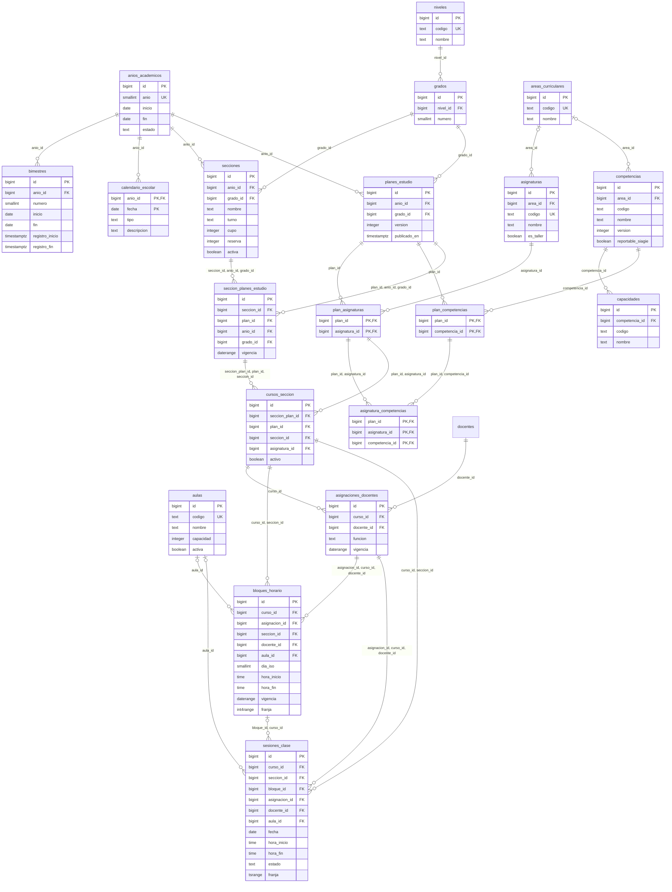
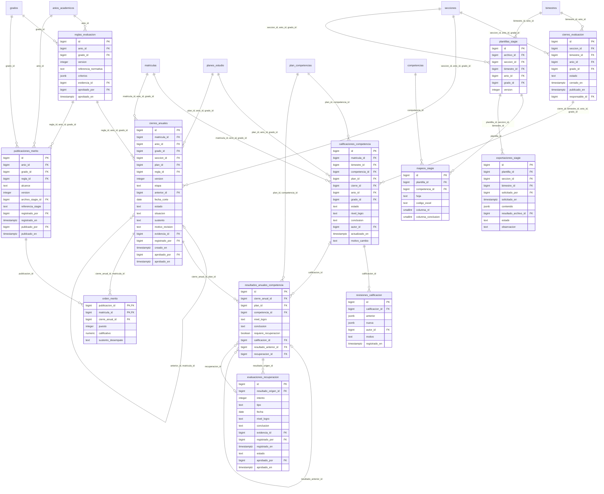

<!-- Archivo generado por scripts/db/generar-docs.mjs a partir del catálogo real. No editar a mano. -->

# Académico y evaluación

Tablas (32): [`anios_academicos`](#anios_academicos), [`bimestres`](#bimestres), [`calendario_escolar`](#calendario_escolar), [`niveles`](#niveles), [`grados`](#grados), [`secciones`](#secciones), [`aulas`](#aulas), [`areas_curriculares`](#areas_curriculares), [`asignaturas`](#asignaturas), [`competencias`](#competencias), [`capacidades`](#capacidades), [`planes_estudio`](#planes_estudio), [`plan_asignaturas`](#plan_asignaturas), [`plan_competencias`](#plan_competencias), [`asignatura_competencias`](#asignatura_competencias), [`seccion_planes_estudio`](#seccion_planes_estudio), [`cursos_seccion`](#cursos_seccion), [`asignaciones_docentes`](#asignaciones_docentes), [`bloques_horario`](#bloques_horario), [`sesiones_clase`](#sesiones_clase), [`cierres_evaluacion`](#cierres_evaluacion), [`calificaciones_competencia`](#calificaciones_competencia), [`revisiones_calificacion`](#revisiones_calificacion), [`reglas_evaluacion`](#reglas_evaluacion), [`cierres_anuales`](#cierres_anuales), [`resultados_anuales_competencia`](#resultados_anuales_competencia), [`evaluaciones_recuperacion`](#evaluaciones_recuperacion), [`publicaciones_merito`](#publicaciones_merito), [`orden_merito`](#orden_merito), [`plantillas_siagie`](#plantillas_siagie), [`mapeos_siagie`](#mapeos_siagie), [`exportaciones_siagie`](#exportaciones_siagie).

## Diagrama ER

> Para legibilidad se omiten las referencias de auditoría/evidencia hacia `usuarios` y `archivos` cuando esas tablas no pertenecen al diagrama; sí figuran en el diccionario.

### Estructura académica, currículo y horarios

### Evaluación por competencias, cierre anual, mérito y SIAGIE

## Diccionario

### anios_academicos

Año escolar (2000–2200) con fechas de inicio/fin y estado borrador/abierto/cerrado.

| Columna | Tipo | Nulo | Defecto / generada | Clave / referencia |
|---|---|---|---|---|
| `id` | bigint | no | identity (always) | PK |
| `anio` | smallint | no |  | UNIQUE |
| `inicio` | date | no |  |  |
| `fin` | date | no |  |  |
| `estado` | text | no | `'borrador'` |  |

**Restricciones**

- **PK** (id)
- **UNIQUE** (anio) — `anios_academicos_anio_key`
- **CHECK** `anios_academicos_anio_check`: `(((anio >= 2000) AND (anio <= 2200)))`
- **CHECK** `anios_academicos_check`: `((fin >= inicio))`
- **CHECK** `anios_academicos_estado_check`: `((estado = ANY (ARRAY['borrador', 'abierto', 'cerrado'])))`

### bimestres

Bimestres del año (número 1–4, sin solapes) y ventana de registro de notas.

| Columna | Tipo | Nulo | Defecto / generada | Clave / referencia |
|---|---|---|---|---|
| `id` | bigint | no | identity (always) | PK |
| `anio_id` | bigint | no |  | → [`anios_academicos`](03-academico-evaluacion.md#anios_academicos).id |
| `numero` | smallint | no |  |  |
| `inicio` | date | no |  |  |
| `fin` | date | no |  |  |
| `registro_inicio` | timestamptz | sí |  |  |
| `registro_fin` | timestamptz | sí |  |  |

**Restricciones**

- **PK** (id)
- **UNIQUE** (anio_id, numero) — `bimestres_anio_id_numero_key`
- **UNIQUE** (id, anio_id) — `bimestres_id_anio_id_key`
- **CHECK** `bimestres_check`: `((fin >= inicio))`
- **CHECK** `bimestres_check1`: `((registro_fin >= registro_inicio))`
- **CHECK** `bimestres_numero_check`: `(((numero >= 1) AND (numero <= 4)))`
- **EXCLUDE** `bimestres_anio_id_daterange_excl`: `USING gist (anio_id WITH =, daterange(inicio, fin, '[]') WITH &&)`

### calendario_escolar

Días lectivos, feriados y no lectivos por año.

| Columna | Tipo | Nulo | Defecto / generada | Clave / referencia |
|---|---|---|---|---|
| `anio_id` | bigint | no |  | PK · → [`anios_academicos`](03-academico-evaluacion.md#anios_academicos).id |
| `fecha` | date | no |  | PK |
| `tipo` | text | no |  |  |
| `descripcion` | text | sí |  |  |

**Restricciones**

- **PK** (anio_id, fecha)
- **CHECK** `calendario_escolar_tipo_check`: `((tipo = ANY (ARRAY['lectivo', 'feriado', 'no_lectivo'])))`

### niveles

Niveles educativos. CHECK actual: solo primaria y secundaria.

Filas sembradas en el dump: **2**.

| Columna | Tipo | Nulo | Defecto / generada | Clave / referencia |
|---|---|---|---|---|
| `id` | bigint | no | identity (always) | PK |
| `codigo` | text | no |  | UNIQUE |
| `nombre` | text | no |  |  |

**Restricciones**

- **PK** (id)
- **UNIQUE** (codigo) — `niveles_codigo_key`
- **CHECK** `niveles_codigo_check`: `((codigo = ANY (ARRAY['primaria', 'secundaria'])))`

### grados

Grados por nivel (número 1–6).

Filas sembradas en el dump: **11**.

| Columna | Tipo | Nulo | Defecto / generada | Clave / referencia |
|---|---|---|---|---|
| `id` | bigint | no | identity (always) | PK |
| `nivel_id` | bigint | no |  | → [`niveles`](03-academico-evaluacion.md#niveles).id |
| `numero` | smallint | no |  |  |

**Restricciones**

- **PK** (id)
- **UNIQUE** (nivel_id, numero) — `grados_nivel_id_numero_key`
- **CHECK** `grados_numero_check`: `(((numero >= 1) AND (numero <= 6)))`

### secciones

Secciones por año y grado: nombre en mayúsculas, turno, cupo y vacantes reservadas (reserva ≤ cupo).

| Columna | Tipo | Nulo | Defecto / generada | Clave / referencia |
|---|---|---|---|---|
| `id` | bigint | no | identity (always) | PK |
| `anio_id` | bigint | no |  | → [`anios_academicos`](03-academico-evaluacion.md#anios_academicos).id |
| `grado_id` | bigint | no |  | → [`grados`](03-academico-evaluacion.md#grados).id |
| `nombre` | text | no |  |  |
| `turno` | text | no |  |  |
| `cupo` | integer | no |  |  |
| `reserva` | integer | no | `2` |  |
| `activa` | boolean | no | `true` |  |

**Restricciones**

- **PK** (id)
- **UNIQUE** (anio_id, grado_id, nombre) — `secciones_anio_id_grado_id_nombre_key`
- **UNIQUE** (id, anio_id, grado_id) — `secciones_id_anio_id_grado_id_key`
- **CHECK** `secciones_check`: `(((reserva >= 0) AND (reserva <= cupo)))`
- **CHECK** `secciones_cupo_check`: `((cupo > 0))`
- **CHECK** `secciones_nombre_check`: `(((nombre = upper(btrim(nombre))) AND (nombre <> '')))`

### aulas

Ambientes físicos con capacidad.

| Columna | Tipo | Nulo | Defecto / generada | Clave / referencia |
|---|---|---|---|---|
| `id` | bigint | no | identity (always) | PK |
| `codigo` | text | no |  | UNIQUE |
| `nombre` | text | no |  |  |
| `capacidad` | integer | sí |  |  |
| `activa` | boolean | no | `true` |  |

**Restricciones**

- **PK** (id)
- **UNIQUE** (codigo) — `aulas_codigo_key`
- **CHECK** `aulas_capacidad_check`: `((capacidad > 0))`

### areas_curriculares

Áreas curriculares (CNEB). Sin semillas.

| Columna | Tipo | Nulo | Defecto / generada | Clave / referencia |
|---|---|---|---|---|
| `id` | bigint | no | identity (always) | PK |
| `codigo` | text | no |  | UNIQUE |
| `nombre` | text | no |  |  |

**Restricciones**

- **PK** (id)
- **UNIQUE** (codigo) — `areas_curriculares_codigo_key`

### asignaturas

Cursos o talleres, opcionalmente asociados a un área curricular.

| Columna | Tipo | Nulo | Defecto / generada | Clave / referencia |
|---|---|---|---|---|
| `id` | bigint | no | identity (always) | PK |
| `area_id` | bigint | sí |  | → [`areas_curriculares`](03-academico-evaluacion.md#areas_curriculares).id |
| `codigo` | text | no |  | UNIQUE |
| `nombre` | text | no |  |  |
| `es_taller` | boolean | no | `false` |  |

**Restricciones**

- **PK** (id)
- **UNIQUE** (codigo) — `asignaturas_codigo_key`

### competencias

Competencias versionadas (código + versión). reportable_siagie indica si va en la exportación SIAGIE.

| Columna | Tipo | Nulo | Defecto / generada | Clave / referencia |
|---|---|---|---|---|
| `id` | bigint | no | identity (always) | PK |
| `area_id` | bigint | sí |  | → [`areas_curriculares`](03-academico-evaluacion.md#areas_curriculares).id |
| `codigo` | text | no |  |  |
| `nombre` | text | no |  |  |
| `version` | integer | no | `1` |  |
| `reportable_siagie` | boolean | no | `true` |  |

**Restricciones**

- **PK** (id)
- **UNIQUE** (codigo, version) — `competencias_codigo_version_key`
- **CHECK** `competencias_version_check`: `((version > 0))`

### capacidades

Capacidades de cada competencia.

| Columna | Tipo | Nulo | Defecto / generada | Clave / referencia |
|---|---|---|---|---|
| `id` | bigint | no | identity (always) | PK |
| `competencia_id` | bigint | no |  | → [`competencias`](03-academico-evaluacion.md#competencias).id |
| `codigo` | text | no |  |  |
| `nombre` | text | no |  |  |

**Restricciones**

- **PK** (id)
- **UNIQUE** (competencia_id, codigo) — `capacidades_competencia_id_codigo_key`

### planes_estudio

Plan de estudios versionado por año y grado; se publica antes de asignarlo a secciones.

| Columna | Tipo | Nulo | Defecto / generada | Clave / referencia |
|---|---|---|---|---|
| `id` | bigint | no | identity (always) | PK |
| `anio_id` | bigint | no |  | → [`anios_academicos`](03-academico-evaluacion.md#anios_academicos).id |
| `grado_id` | bigint | no |  | → [`grados`](03-academico-evaluacion.md#grados).id |
| `version` | integer | no |  |  |
| `publicado_en` | timestamptz | sí |  |  |

**Restricciones**

- **PK** (id)
- **UNIQUE** (anio_id, grado_id, version) — `planes_estudio_anio_id_grado_id_version_key`
- **UNIQUE** (id, anio_id, grado_id) — `planes_estudio_id_anio_id_grado_id_key`
- **CHECK** `planes_estudio_version_check`: `((version > 0))`

### plan_asignaturas

Asignaturas incluidas en un plan.

| Columna | Tipo | Nulo | Defecto / generada | Clave / referencia |
|---|---|---|---|---|
| `plan_id` | bigint | no |  | PK · → [`planes_estudio`](03-academico-evaluacion.md#planes_estudio).id |
| `asignatura_id` | bigint | no |  | PK · → [`asignaturas`](03-academico-evaluacion.md#asignaturas).id |

**Restricciones**

- **PK** (plan_id, asignatura_id)

### plan_competencias

Competencias evaluadas en un plan.

| Columna | Tipo | Nulo | Defecto / generada | Clave / referencia |
|---|---|---|---|---|
| `plan_id` | bigint | no |  | PK · → [`planes_estudio`](03-academico-evaluacion.md#planes_estudio).id |
| `competencia_id` | bigint | no |  | PK · → [`competencias`](03-academico-evaluacion.md#competencias).id |

**Restricciones**

- **PK** (plan_id, competencia_id)

### asignatura_competencias

Competencias del plan que califica cada asignatura (base del alcance del docente).

| Columna | Tipo | Nulo | Defecto / generada | Clave / referencia |
|---|---|---|---|---|
| `plan_id` | bigint | no |  | PK · → [`plan_asignaturas`](03-academico-evaluacion.md#plan_asignaturas) (FK compuesta) · → [`plan_competencias`](03-academico-evaluacion.md#plan_competencias) (FK compuesta) |
| `asignatura_id` | bigint | no |  | PK · → [`plan_asignaturas`](03-academico-evaluacion.md#plan_asignaturas) (FK compuesta) |
| `competencia_id` | bigint | no |  | PK · → [`plan_competencias`](03-academico-evaluacion.md#plan_competencias) (FK compuesta) |

**Restricciones**

- **PK** (plan_id, asignatura_id, competencia_id)
- **FK** (plan_id, asignatura_id) → [`plan_asignaturas`](03-academico-evaluacion.md#plan_asignaturas) (plan_id, asignatura_id)
- **FK** (plan_id, competencia_id) → [`plan_competencias`](03-academico-evaluacion.md#plan_competencias) (plan_id, competencia_id)

### seccion_planes_estudio

Plan aplicado a una sección con vigencia sin solapes.

| Columna | Tipo | Nulo | Defecto / generada | Clave / referencia |
|---|---|---|---|---|
| `id` | bigint | no | identity (always) | PK |
| `seccion_id` | bigint | no |  | → [`secciones`](03-academico-evaluacion.md#secciones) (FK compuesta) |
| `plan_id` | bigint | no |  | → [`planes_estudio`](03-academico-evaluacion.md#planes_estudio) (FK compuesta) |
| `anio_id` | bigint | no |  | → [`planes_estudio`](03-academico-evaluacion.md#planes_estudio) (FK compuesta) · → [`secciones`](03-academico-evaluacion.md#secciones) (FK compuesta) |
| `grado_id` | bigint | no |  | → [`planes_estudio`](03-academico-evaluacion.md#planes_estudio) (FK compuesta) · → [`secciones`](03-academico-evaluacion.md#secciones) (FK compuesta) |
| `vigencia` | daterange | no |  |  |

**Restricciones**

- **PK** (id)
- **UNIQUE** (id, plan_id, seccion_id) — `seccion_planes_estudio_id_plan_id_seccion_id_key`
- **FK** (plan_id, anio_id, grado_id) → [`planes_estudio`](03-academico-evaluacion.md#planes_estudio) (id, anio_id, grado_id)
- **FK** (seccion_id, anio_id, grado_id) → [`secciones`](03-academico-evaluacion.md#secciones) (id, anio_id, grado_id)
- **CHECK** `seccion_planes_estudio_vigencia_check`: `(((NOT isempty(vigencia)) AND (NOT lower_inf(vigencia)) AND (NOT upper_inf(vigencia))))`
- **EXCLUDE** `seccion_planes_estudio_seccion_id_vigencia_excl`: `USING gist (seccion_id WITH =, vigencia WITH &&)`

**Triggers**

- `controlar_plan_seccion` — BEFORE INSERT OR UPDATE → [`validar_plan_seccion()`](../funciones.md#validar_plan_seccion)

### cursos_seccion

Curso concreto: asignatura de un plan dictada en una sección.

| Columna | Tipo | Nulo | Defecto / generada | Clave / referencia |
|---|---|---|---|---|
| `id` | bigint | no | identity (always) | PK |
| `seccion_plan_id` | bigint | no |  | → [`seccion_planes_estudio`](03-academico-evaluacion.md#seccion_planes_estudio) (FK compuesta) |
| `plan_id` | bigint | no |  | → [`plan_asignaturas`](03-academico-evaluacion.md#plan_asignaturas) (FK compuesta) · → [`seccion_planes_estudio`](03-academico-evaluacion.md#seccion_planes_estudio) (FK compuesta) |
| `seccion_id` | bigint | no |  | → [`seccion_planes_estudio`](03-academico-evaluacion.md#seccion_planes_estudio) (FK compuesta) |
| `asignatura_id` | bigint | no |  | → [`plan_asignaturas`](03-academico-evaluacion.md#plan_asignaturas) (FK compuesta) |
| `activo` | boolean | no | `true` |  |

**Restricciones**

- **PK** (id)
- **UNIQUE** (id, seccion_id) — `cursos_seccion_id_seccion_id_key`
- **UNIQUE** (seccion_plan_id, asignatura_id) — `cursos_seccion_seccion_plan_id_asignatura_id_key`
- **FK** (plan_id, asignatura_id) → [`plan_asignaturas`](03-academico-evaluacion.md#plan_asignaturas) (plan_id, asignatura_id)
- **FK** (seccion_plan_id, plan_id, seccion_id) → [`seccion_planes_estudio`](03-academico-evaluacion.md#seccion_planes_estudio) (id, plan_id, seccion_id)

### asignaciones_docentes

Docente asignado a un curso (titular, reemplazo o apoyo) con vigencia sin solapes.

| Columna | Tipo | Nulo | Defecto / generada | Clave / referencia |
|---|---|---|---|---|
| `id` | bigint | no | identity (always) | PK |
| `curso_id` | bigint | no |  | → [`cursos_seccion`](03-academico-evaluacion.md#cursos_seccion).id |
| `docente_id` | bigint | no |  | → [`docentes`](06-personal-planilla.md#docentes).id |
| `funcion` | text | no |  |  |
| `vigencia` | daterange | no |  |  |

**Restricciones**

- **PK** (id)
- **UNIQUE** (id, curso_id, docente_id) — `asignaciones_docentes_id_curso_id_docente_id_key`
- **CHECK** `asignaciones_docentes_funcion_check`: `((funcion = ANY (ARRAY['titular', 'reemplazo', 'apoyo'])))`
- **CHECK** `asignaciones_docentes_vigencia_check`: `(((NOT isempty(vigencia)) AND (NOT lower_inf(vigencia)) AND (NOT upper_inf(vigencia))))`
- **EXCLUDE** `asignaciones_docentes_curso_id_docente_id_vigencia_excl`: `USING gist (curso_id WITH =, docente_id WITH =, vigencia WITH &&)`

**Triggers**

- `controlar_asignacion` — BEFORE INSERT OR UPDATE → [`validar_vigencia_horario()`](../funciones.md#validar_vigencia_horario)

### bloques_horario

Horario semanal recurrente. Exclusiones impiden cruces por sección, docente y aula.

| Columna | Tipo | Nulo | Defecto / generada | Clave / referencia |
|---|---|---|---|---|
| `id` | bigint | no | identity (always) | PK |
| `curso_id` | bigint | no |  | → [`asignaciones_docentes`](03-academico-evaluacion.md#asignaciones_docentes) (FK compuesta) · → [`cursos_seccion`](03-academico-evaluacion.md#cursos_seccion) (FK compuesta) |
| `asignacion_id` | bigint | no |  | → [`asignaciones_docentes`](03-academico-evaluacion.md#asignaciones_docentes) (FK compuesta) |
| `seccion_id` | bigint | no |  | → [`cursos_seccion`](03-academico-evaluacion.md#cursos_seccion) (FK compuesta) |
| `docente_id` | bigint | no |  | → [`asignaciones_docentes`](03-academico-evaluacion.md#asignaciones_docentes) (FK compuesta) |
| `aula_id` | bigint | sí |  | → [`aulas`](03-academico-evaluacion.md#aulas).id |
| `dia_iso` | smallint | no |  |  |
| `hora_inicio` | time | no |  |  |
| `hora_fin` | time | no |  |  |
| `vigencia` | daterange | no |  |  |
| `franja` | int4range | sí | generada: `int4range((EXTRACT(epoch FROM hora_inicio)), (EXTRACT(epoch FROM hora_fin)), '[)')` |  |

**Restricciones**

- **PK** (id)
- **UNIQUE** (id, curso_id) — `bloques_horario_id_curso_id_key`
- **FK** (asignacion_id, curso_id, docente_id) → [`asignaciones_docentes`](03-academico-evaluacion.md#asignaciones_docentes) (id, curso_id, docente_id)
- **FK** (curso_id, seccion_id) → [`cursos_seccion`](03-academico-evaluacion.md#cursos_seccion) (id, seccion_id)
- **CHECK** `bloques_horario_check`: `(((hora_inicio < hora_fin) AND (EXTRACT(second FROM hora_inicio) = (0)) AND (EXTRACT(second FROM hora_fin) = (0))))`
- **CHECK** `bloques_horario_dia_iso_check`: `(((dia_iso >= 1) AND (dia_iso <= 7)))`
- **CHECK** `bloques_horario_vigencia_check`: `(((NOT isempty(vigencia)) AND (NOT lower_inf(vigencia)) AND (NOT upper_inf(vigencia))))`
- **EXCLUDE** `bloques_horario_aula_id_dia_iso_vigencia_franja_excl`: `USING gist (aula_id WITH =, dia_iso WITH =, vigencia WITH &&, franja WITH &&)`
- **EXCLUDE** `bloques_horario_docente_id_dia_iso_vigencia_franja_excl`: `USING gist (docente_id WITH =, dia_iso WITH =, vigencia WITH &&, franja WITH &&)`
- **EXCLUDE** `bloques_horario_seccion_id_dia_iso_vigencia_franja_excl`: `USING gist (seccion_id WITH =, dia_iso WITH =, vigencia WITH &&, franja WITH &&)`

**Triggers**

- `controlar_bloque` — BEFORE INSERT OR UPDATE → [`validar_vigencia_horario()`](../funciones.md#validar_vigencia_horario)

### sesiones_clase

Sesiones de clase fechadas (programada, realizada, cancelada). Base de la asistencia por sesión y de las horas docentes.

| Columna | Tipo | Nulo | Defecto / generada | Clave / referencia |
|---|---|---|---|---|
| `id` | bigint | no | identity (always) | PK |
| `curso_id` | bigint | no |  | → [`asignaciones_docentes`](03-academico-evaluacion.md#asignaciones_docentes) (FK compuesta) · → [`bloques_horario`](03-academico-evaluacion.md#bloques_horario) (FK compuesta) · → [`cursos_seccion`](03-academico-evaluacion.md#cursos_seccion) (FK compuesta) |
| `seccion_id` | bigint | no |  | → [`cursos_seccion`](03-academico-evaluacion.md#cursos_seccion) (FK compuesta) |
| `bloque_id` | bigint | sí |  | → [`bloques_horario`](03-academico-evaluacion.md#bloques_horario) (FK compuesta) |
| `asignacion_id` | bigint | no |  | → [`asignaciones_docentes`](03-academico-evaluacion.md#asignaciones_docentes) (FK compuesta) |
| `docente_id` | bigint | no |  | → [`asignaciones_docentes`](03-academico-evaluacion.md#asignaciones_docentes) (FK compuesta) |
| `aula_id` | bigint | sí |  | → [`aulas`](03-academico-evaluacion.md#aulas).id |
| `fecha` | date | no |  |  |
| `hora_inicio` | time | no |  |  |
| `hora_fin` | time | no |  |  |
| `estado` | text | no | `'programada'` |  |
| `franja` | tsrange | sí | generada: `tsrange((fecha + hora_inicio), (fecha + hora_fin), '[)')` |  |

**Restricciones**

- **PK** (id)
- **FK** (asignacion_id, curso_id, docente_id) → [`asignaciones_docentes`](03-academico-evaluacion.md#asignaciones_docentes) (id, curso_id, docente_id)
- **FK** (bloque_id, curso_id) → [`bloques_horario`](03-academico-evaluacion.md#bloques_horario) (id, curso_id)
- **FK** (curso_id, seccion_id) → [`cursos_seccion`](03-academico-evaluacion.md#cursos_seccion) (id, seccion_id)
- **CHECK** `sesiones_clase_check`: `((hora_inicio < hora_fin))`
- **CHECK** `sesiones_clase_estado_check`: `((estado = ANY (ARRAY['programada', 'realizada', 'cancelada'])))`
- **EXCLUDE** `sesiones_clase_aula_id_franja_excl`: `USING gist (aula_id WITH =, franja WITH &&) WHERE ((estado <> 'cancelada'))`
- **EXCLUDE** `sesiones_clase_docente_id_franja_excl`: `USING gist (docente_id WITH =, franja WITH &&) WHERE ((estado <> 'cancelada'))`
- **EXCLUDE** `sesiones_clase_seccion_id_franja_excl`: `USING gist (seccion_id WITH =, franja WITH &&) WHERE ((estado <> 'cancelada'))`

**Triggers**

- `controlar_sesion` — BEFORE INSERT OR UPDATE → [`validar_vigencia_horario()`](../funciones.md#validar_vigencia_horario)

### cierres_evaluacion

Cierre por sección y bimestre: borrador → cerrado → publicado (se puede reabrir a borrador).

| Columna | Tipo | Nulo | Defecto / generada | Clave / referencia |
|---|---|---|---|---|
| `id` | bigint | no | identity (always) | PK |
| `seccion_id` | bigint | no |  | → [`secciones`](03-academico-evaluacion.md#secciones) (FK compuesta) |
| `bimestre_id` | bigint | no |  | → [`bimestres`](03-academico-evaluacion.md#bimestres) (FK compuesta) |
| `anio_id` | bigint | no |  | → [`bimestres`](03-academico-evaluacion.md#bimestres) (FK compuesta) · → [`secciones`](03-academico-evaluacion.md#secciones) (FK compuesta) |
| `grado_id` | bigint | no |  | → [`secciones`](03-academico-evaluacion.md#secciones) (FK compuesta) |
| `estado` | text | no | `'borrador'` |  |
| `cerrado_en` | timestamptz | sí |  |  |
| `publicado_en` | timestamptz | sí |  |  |
| `responsable_id` | bigint | no |  | → [`usuarios`](01-identidad-permisos.md#usuarios).id |

**Restricciones**

- **PK** (id)
- **UNIQUE** (id, bimestre_id, anio_id, grado_id) — `cierres_evaluacion_id_bimestre_id_anio_id_grado_id_key`
- **UNIQUE** (seccion_id, bimestre_id) — `cierres_evaluacion_seccion_id_bimestre_id_key`
- **FK** (bimestre_id, anio_id) → [`bimestres`](03-academico-evaluacion.md#bimestres) (id, anio_id)
- **FK** (seccion_id, anio_id, grado_id) → [`secciones`](03-academico-evaluacion.md#secciones) (id, anio_id, grado_id)
- **CHECK** `cierres_evaluacion_check`: `(((estado = 'borrador') = (cerrado_en IS NULL)))`
- **CHECK** `cierres_evaluacion_check1`: `(((estado = 'publicado') = (publicado_en IS NOT NULL)))`
- **CHECK** `cierres_evaluacion_check2`: `((publicado_en >= cerrado_en))`
- **CHECK** `cierres_evaluacion_estado_check`: `((estado = ANY (ARRAY['borrador', 'cerrado', 'publicado'])))`

**Triggers**

- `controlar_cierre` — BEFORE INSERT OR UPDATE → [`validar_cierre_evaluacion()`](../funciones.md#validar_cierre_evaluacion)

### calificaciones_competencia

Nivel de logro (AD, A, B, C) y conclusión descriptiva por matrícula, competencia y bimestre. Se rectifica con motivo; no se borra.

| Columna | Tipo | Nulo | Defecto / generada | Clave / referencia |
|---|---|---|---|---|
| `id` | bigint | no | identity (always) | PK |
| `matricula_id` | bigint | no |  | → [`matriculas`](02-matricula.md#matriculas) (FK compuesta) |
| `bimestre_id` | bigint | no |  | → [`cierres_evaluacion`](03-academico-evaluacion.md#cierres_evaluacion) (FK compuesta) |
| `competencia_id` | bigint | no |  | → [`plan_competencias`](03-academico-evaluacion.md#plan_competencias) (FK compuesta) |
| `plan_id` | bigint | no |  | → [`planes_estudio`](03-academico-evaluacion.md#planes_estudio) (FK compuesta) · → [`plan_competencias`](03-academico-evaluacion.md#plan_competencias) (FK compuesta) |
| `cierre_id` | bigint | no |  | → [`cierres_evaluacion`](03-academico-evaluacion.md#cierres_evaluacion) (FK compuesta) |
| `anio_id` | bigint | no |  | → [`cierres_evaluacion`](03-academico-evaluacion.md#cierres_evaluacion) (FK compuesta) · → [`matriculas`](02-matricula.md#matriculas) (FK compuesta) · → [`planes_estudio`](03-academico-evaluacion.md#planes_estudio) (FK compuesta) |
| `grado_id` | bigint | no |  | → [`cierres_evaluacion`](03-academico-evaluacion.md#cierres_evaluacion) (FK compuesta) · → [`matriculas`](02-matricula.md#matriculas) (FK compuesta) · → [`planes_estudio`](03-academico-evaluacion.md#planes_estudio) (FK compuesta) |
| `estado` | text | no |  |  |
| `nivel_logro` | text | sí |  |  |
| `conclusion` | text | sí |  |  |
| `autor_id` | bigint | no |  | → [`usuarios`](01-identidad-permisos.md#usuarios).id |
| `actualizado_en` | timestamptz | no | `now()` |  |
| `motivo_cambio` | text | sí |  |  |

**Restricciones**

- **PK** (id)
- **UNIQUE** (matricula_id, bimestre_id, competencia_id) — `calificaciones_competencia_matricula_id_bimestre_id_compete_key`
- **FK** (cierre_id, bimestre_id, anio_id, grado_id) → [`cierres_evaluacion`](03-academico-evaluacion.md#cierres_evaluacion) (id, bimestre_id, anio_id, grado_id)
- **FK** (matricula_id, anio_id, grado_id) → [`matriculas`](02-matricula.md#matriculas) (id, anio_id, grado_id)
- **FK** (plan_id, anio_id, grado_id) → [`planes_estudio`](03-academico-evaluacion.md#planes_estudio) (id, anio_id, grado_id)
- **FK** (plan_id, competencia_id) → [`plan_competencias`](03-academico-evaluacion.md#plan_competencias) (plan_id, competencia_id)
- **CHECK** `calificaciones_competencia_check`: `(((estado = 'evaluada') = (nivel_logro IS NOT NULL)))`
- **CHECK** `calificaciones_competencia_check1`: `(((estado = 'evaluada') OR (conclusion IS NULL)))`
- **CHECK** `calificaciones_competencia_estado_check`: `((estado = ANY (ARRAY['pendiente', 'no_desarrollada', 'evaluada'])))`
- **CHECK** `calificaciones_competencia_nivel_logro_check`: `((nivel_logro = ANY (ARRAY['C', 'B', 'A', 'AD'])))`

**Índices adicionales**

- `calificaciones_cierre_idx`: `USING btree (cierre_id)`

**Triggers**

- `auditar_calificacion` — AFTER UPDATE → [`registrar_revision_calificacion()`](../funciones.md#registrar_revision_calificacion)
- `conservar_calificacion` — BEFORE DELETE → [`conservar_calificacion()`](../funciones.md#conservar_calificacion)
- `controlar_calificacion` — BEFORE INSERT OR UPDATE → [`validar_calificacion()`](../funciones.md#validar_calificacion)

### revisiones_calificacion

Historial automático (trigger) de cada rectificación de calificación.

| Columna | Tipo | Nulo | Defecto / generada | Clave / referencia |
|---|---|---|---|---|
| `id` | bigint | no | identity (always) | PK |
| `calificacion_id` | bigint | no |  | → [`calificaciones_competencia`](03-academico-evaluacion.md#calificaciones_competencia).id |
| `anterior` | jsonb | no |  |  |
| `nueva` | jsonb | no |  |  |
| `autor_id` | bigint | no |  | → [`usuarios`](01-identidad-permisos.md#usuarios).id |
| `motivo` | text | no |  |  |
| `registrado_en` | timestamptz | no | `now()` |  |

**Restricciones**

- **PK** (id)

### reglas_evaluacion

Reglas de promoción/situación final versionadas por año y grado (criterios jsonb). Inmutables una vez aprobadas. Sin semillas.

| Columna | Tipo | Nulo | Defecto / generada | Clave / referencia |
|---|---|---|---|---|
| `id` | bigint | no | identity (always) | PK |
| `anio_id` | bigint | no |  | → [`anios_academicos`](03-academico-evaluacion.md#anios_academicos).id |
| `grado_id` | bigint | no |  | → [`grados`](03-academico-evaluacion.md#grados).id |
| `version` | integer | no |  |  |
| `referencia_normativa` | text | no |  |  |
| `criterios` | jsonb | no |  |  |
| `evidencia_id` | bigint | sí |  | → [`archivos`](07-documentos-reportes.md#archivos).id |
| `aprobado_por` | bigint | sí |  | → [`usuarios`](01-identidad-permisos.md#usuarios).id |
| `aprobado_en` | timestamptz | sí |  |  |

**Restricciones**

- **PK** (id)
- **UNIQUE** (anio_id, grado_id, version) — `reglas_evaluacion_anio_id_grado_id_version_key`
- **UNIQUE** (id, anio_id, grado_id) — `reglas_evaluacion_id_anio_id_grado_id_key`
- **CHECK** `reglas_evaluacion_check`: `(((aprobado_por IS NULL) = (aprobado_en IS NULL)))`
- **CHECK** `reglas_evaluacion_criterios_check`: `(((jsonb_typeof(criterios) = 'object') AND (criterios <> '{}'::jsonb)))`
- **CHECK** `reglas_evaluacion_referencia_normativa_check`: `((btrim(referencia_normativa) <> ''))`
- **CHECK** `reglas_evaluacion_version_check`: `((version > 0))`

**Triggers**

- `proteger_regla_evaluacion` — BEFORE DELETE OR UPDATE → [`proteger_regla_evaluacion()`](../funciones.md#proteger_regla_evaluacion)

### cierres_anuales

Cierre anual por matrícula versionado (ordinario, rectificación, recuperación) con situación final: promovido, recuperación o permanencia.

| Columna | Tipo | Nulo | Defecto / generada | Clave / referencia |
|---|---|---|---|---|
| `id` | bigint | no | identity (always) | PK |
| `matricula_id` | bigint | no |  | → [`cierres_anuales`](03-academico-evaluacion.md#cierres_anuales) (FK compuesta) · → [`matriculas`](02-matricula.md#matriculas) (FK compuesta) |
| `anio_id` | bigint | no |  | → [`matriculas`](02-matricula.md#matriculas) (FK compuesta) · → [`planes_estudio`](03-academico-evaluacion.md#planes_estudio) (FK compuesta) · → [`reglas_evaluacion`](03-academico-evaluacion.md#reglas_evaluacion) (FK compuesta) · → [`secciones`](03-academico-evaluacion.md#secciones) (FK compuesta) |
| `grado_id` | bigint | no |  | → [`matriculas`](02-matricula.md#matriculas) (FK compuesta) · → [`planes_estudio`](03-academico-evaluacion.md#planes_estudio) (FK compuesta) · → [`reglas_evaluacion`](03-academico-evaluacion.md#reglas_evaluacion) (FK compuesta) · → [`secciones`](03-academico-evaluacion.md#secciones) (FK compuesta) |
| `seccion_id` | bigint | no |  | → [`secciones`](03-academico-evaluacion.md#secciones) (FK compuesta) |
| `plan_id` | bigint | no |  | → [`planes_estudio`](03-academico-evaluacion.md#planes_estudio) (FK compuesta) |
| `regla_id` | bigint | no |  | → [`reglas_evaluacion`](03-academico-evaluacion.md#reglas_evaluacion) (FK compuesta) |
| `version` | integer | no |  |  |
| `etapa` | text | no |  |  |
| `anterior_id` | bigint | sí |  | → [`cierres_anuales`](03-academico-evaluacion.md#cierres_anuales) (FK compuesta) |
| `fecha_corte` | date | no |  |  |
| `estado` | text | no | `'borrador'` |  |
| `situacion` | text | sí |  |  |
| `sustento` | text | sí |  |  |
| `motivo_revision` | text | sí |  |  |
| `evidencia_id` | bigint | sí |  | → [`archivos`](07-documentos-reportes.md#archivos).id |
| `registrado_por` | bigint | no |  | → [`usuarios`](01-identidad-permisos.md#usuarios).id |
| `creado_en` | timestamptz | no | `clock_timestamp()` |  |
| `aprobado_por` | bigint | sí |  | → [`usuarios`](01-identidad-permisos.md#usuarios).id |
| `aprobado_en` | timestamptz | sí |  |  |

**Restricciones**

- **PK** (id)
- **UNIQUE** (id, matricula_id) — `cierres_anuales_id_matricula_id_key`
- **UNIQUE** (id, plan_id) — `cierres_anuales_id_plan_id_key`
- **UNIQUE** (matricula_id, version) — `cierres_anuales_matricula_id_version_key`
- **FK** (anterior_id, matricula_id) → [`cierres_anuales`](03-academico-evaluacion.md#cierres_anuales) (id, matricula_id)
- **FK** (matricula_id, anio_id, grado_id) → [`matriculas`](02-matricula.md#matriculas) (id, anio_id, grado_id)
- **FK** (plan_id, anio_id, grado_id) → [`planes_estudio`](03-academico-evaluacion.md#planes_estudio) (id, anio_id, grado_id)
- **FK** (regla_id, anio_id, grado_id) → [`reglas_evaluacion`](03-academico-evaluacion.md#reglas_evaluacion) (id, anio_id, grado_id)
- **FK** (seccion_id, anio_id, grado_id) → [`secciones`](03-academico-evaluacion.md#secciones) (id, anio_id, grado_id)
- **CHECK** `cierres_anuales_check`: `(((version = 1) = (etapa = 'ordinario')))`
- **CHECK** `cierres_anuales_check1`: `((((etapa = 'ordinario') AND (anterior_id IS NULL)) OR ((etapa <> 'ordinario') AND (anterior_id IS NOT NULL) AND (motivo_revision IS NOT NULL) AND (btrim(motivo_revision) <> ''))))`
- **CHECK** `cierres_anuales_check2`: `((((estado = 'borrador') AND (aprobado_por IS NULL) AND (aprobado_en IS NULL)) OR ((estado = 'aprobado') AND (aprobado_por IS NOT NULL) AND (aprobado_en IS NOT NULL) AND (aprobado_en >= creado_en) AND (situacion IS NOT NULL) AND (sustento IS NOT NULL) AND (btrim(sustento) <> ''))))`
- **CHECK** `cierres_anuales_estado_check`: `((estado = ANY (ARRAY['borrador', 'aprobado'])))`
- **CHECK** `cierres_anuales_etapa_check`: `((etapa = ANY (ARRAY['ordinario', 'rectificacion', 'recuperacion'])))`
- **CHECK** `cierres_anuales_situacion_check`: `((situacion = ANY (ARRAY['promovido', 'recuperacion', 'permanencia'])))`
- **CHECK** `cierres_anuales_version_check`: `((version > 0))`

**Triggers**

- `auditar_cierre_anual` — AFTER UPDATE WHEN `(old.estado <> new.estado)` → [`auditar_cierre_academico()`](../funciones.md#auditar_cierre_academico)
- `controlar_cierre_anual` — BEFORE INSERT OR DELETE OR UPDATE → [`controlar_cierre_anual()`](../funciones.md#controlar_cierre_anual)

### resultados_anuales_competencia

Resultado anual por competencia; el trigger copia nivel y conclusión desde la fuente (último logro publicado, recuperación o versión anterior).

| Columna | Tipo | Nulo | Defecto / generada | Clave / referencia |
|---|---|---|---|---|
| `id` | bigint | no | identity (always) | PK |
| `cierre_anual_id` | bigint | no |  | → [`cierres_anuales`](03-academico-evaluacion.md#cierres_anuales) (FK compuesta) |
| `plan_id` | bigint | no |  | → [`cierres_anuales`](03-academico-evaluacion.md#cierres_anuales) (FK compuesta) · → [`plan_competencias`](03-academico-evaluacion.md#plan_competencias) (FK compuesta) |
| `competencia_id` | bigint | no |  | → [`plan_competencias`](03-academico-evaluacion.md#plan_competencias) (FK compuesta) |
| `nivel_logro` | text | no |  |  |
| `conclusion` | text | sí |  |  |
| `requiere_recuperacion` | boolean | no | `false` |  |
| `calificacion_id` | bigint | sí |  | → [`calificaciones_competencia`](03-academico-evaluacion.md#calificaciones_competencia).id |
| `resultado_anterior_id` | bigint | sí |  | → [`resultados_anuales_competencia`](03-academico-evaluacion.md#resultados_anuales_competencia).id |
| `recuperacion_id` | bigint | sí |  | → [`evaluaciones_recuperacion`](03-academico-evaluacion.md#evaluaciones_recuperacion).id |

**Restricciones**

- **PK** (id)
- **UNIQUE** (cierre_anual_id, competencia_id) — `resultados_anuales_competenci_cierre_anual_id_competencia_i_key`
- **FK** (cierre_anual_id, plan_id) → [`cierres_anuales`](03-academico-evaluacion.md#cierres_anuales) (id, plan_id)
- **FK** (plan_id, competencia_id) → [`plan_competencias`](03-academico-evaluacion.md#plan_competencias) (plan_id, competencia_id)
- **CHECK** `resultados_anuales_competencia_check`: `((num_nonnulls(calificacion_id, resultado_anterior_id, recuperacion_id) = 1))`
- **CHECK** `resultados_anuales_competencia_nivel_logro_check`: `((nivel_logro = ANY (ARRAY['C', 'B', 'A', 'AD'])))`

**Triggers**

- `controlar_resultado_anual` — BEFORE INSERT OR DELETE OR UPDATE → [`controlar_resultado_anual()`](../funciones.md#controlar_resultado_anual)

### evaluaciones_recuperacion

Evaluaciones de recuperación o subsanación sobre competencias pendientes de un cierre aprobado.

| Columna | Tipo | Nulo | Defecto / generada | Clave / referencia |
|---|---|---|---|---|
| `id` | bigint | no | identity (always) | PK |
| `resultado_origen_id` | bigint | no |  | → [`resultados_anuales_competencia`](03-academico-evaluacion.md#resultados_anuales_competencia).id |
| `intento` | integer | no |  |  |
| `tipo` | text | no |  |  |
| `fecha` | date | no |  |  |
| `nivel_logro` | text | no |  |  |
| `conclusion` | text | sí |  |  |
| `evidencia_id` | bigint | sí |  | → [`archivos`](07-documentos-reportes.md#archivos).id |
| `registrado_por` | bigint | no |  | → [`usuarios`](01-identidad-permisos.md#usuarios).id |
| `registrado_en` | timestamptz | no | `clock_timestamp()` |  |
| `estado` | text | no | `'borrador'` |  |
| `aprobado_por` | bigint | sí |  | → [`usuarios`](01-identidad-permisos.md#usuarios).id |
| `aprobado_en` | timestamptz | sí |  |  |

**Restricciones**

- **PK** (id)
- **UNIQUE** (resultado_origen_id, intento) — `evaluaciones_recuperacion_resultado_origen_id_intento_key`
- **CHECK** `evaluaciones_recuperacion_check`: `((((estado = 'borrador') AND (aprobado_por IS NULL) AND (aprobado_en IS NULL)) OR ((estado = 'aprobada') AND (aprobado_por IS NOT NULL) AND (aprobado_en >= registrado_en) AND (aprobado_en IS NOT NULL))))`
- **CHECK** `evaluaciones_recuperacion_estado_check`: `((estado = ANY (ARRAY['borrador', 'aprobada'])))`
- **CHECK** `evaluaciones_recuperacion_intento_check`: `((intento > 0))`
- **CHECK** `evaluaciones_recuperacion_nivel_logro_check`: `((nivel_logro = ANY (ARRAY['C', 'B', 'A', 'AD'])))`
- **CHECK** `evaluaciones_recuperacion_tipo_check`: `((tipo = ANY (ARRAY['recuperacion', 'subsanacion'])))`

**Triggers**

- `auditar_recuperacion` — AFTER UPDATE WHEN `(old.estado <> new.estado)` → [`auditar_cierre_academico()`](../funciones.md#auditar_cierre_academico)
- `controlar_evaluacion_recuperacion` — BEFORE INSERT OR DELETE OR UPDATE → [`controlar_evaluacion_recuperacion()`](../funciones.md#controlar_evaluacion_recuperacion)

### publicaciones_merito

Publicación versionada del orden de mérito oficial (archivo y referencia SIAGIE) por año, grado y alcance.

| Columna | Tipo | Nulo | Defecto / generada | Clave / referencia |
|---|---|---|---|---|
| `id` | bigint | no | identity (always) | PK |
| `anio_id` | bigint | no |  | → [`anios_academicos`](03-academico-evaluacion.md#anios_academicos).id · → [`reglas_evaluacion`](03-academico-evaluacion.md#reglas_evaluacion) (FK compuesta) |
| `grado_id` | bigint | no |  | → [`grados`](03-academico-evaluacion.md#grados).id · → [`reglas_evaluacion`](03-academico-evaluacion.md#reglas_evaluacion) (FK compuesta) |
| `regla_id` | bigint | no |  | → [`reglas_evaluacion`](03-academico-evaluacion.md#reglas_evaluacion) (FK compuesta) |
| `alcance` | text | no |  |  |
| `version` | integer | no |  |  |
| `archivo_siagie_id` | bigint | no |  | → [`archivos`](07-documentos-reportes.md#archivos).id |
| `referencia_siagie` | text | no |  |  |
| `registrado_por` | bigint | no |  | → [`usuarios`](01-identidad-permisos.md#usuarios).id |
| `registrado_en` | timestamptz | no | `clock_timestamp()` |  |
| `publicado_por` | bigint | sí |  | → [`usuarios`](01-identidad-permisos.md#usuarios).id |
| `publicado_en` | timestamptz | sí |  |  |

**Restricciones**

- **PK** (id)
- **UNIQUE** (anio_id, grado_id, alcance, version) — `publicaciones_merito_anio_id_grado_id_alcance_version_key`
- **FK** (regla_id, anio_id, grado_id) → [`reglas_evaluacion`](03-academico-evaluacion.md#reglas_evaluacion) (id, anio_id, grado_id)
- **CHECK** `publicaciones_merito_alcance_check`: `((alcance = ANY (ARRAY['grado', 'secundaria_completa'])))`
- **CHECK** `publicaciones_merito_check`: `(((publicado_por IS NULL) = (publicado_en IS NULL)))`
- **CHECK** `publicaciones_merito_check1`: `((publicado_en >= registrado_en))`
- **CHECK** `publicaciones_merito_referencia_siagie_check`: `((btrim(referencia_siagie) <> ''))`
- **CHECK** `publicaciones_merito_version_check`: `((version > 0))`

**Triggers**

- `auditar_merito` — AFTER UPDATE WHEN `(old.publicado_en IS DISTINCT FROM new.publicado_en)` → [`auditar_cierre_academico()`](../funciones.md#auditar_cierre_academico)
- `controlar_publicacion_merito` — BEFORE INSERT OR DELETE OR UPDATE → [`controlar_publicacion_merito()`](../funciones.md#controlar_publicacion_merito)

### orden_merito

Puestos del listado de mérito (calificativo entre 2.5 y 10).

| Columna | Tipo | Nulo | Defecto / generada | Clave / referencia |
|---|---|---|---|---|
| `publicacion_id` | bigint | no |  | PK · → [`publicaciones_merito`](03-academico-evaluacion.md#publicaciones_merito).id |
| `matricula_id` | bigint | no |  | PK · → [`cierres_anuales`](03-academico-evaluacion.md#cierres_anuales) (FK compuesta) |
| `cierre_anual_id` | bigint | no |  | → [`cierres_anuales`](03-academico-evaluacion.md#cierres_anuales) (FK compuesta) |
| `puesto` | integer | no |  |  |
| `calificativo` | numeric(6,3) | no |  |  |
| `sustento_desempate` | text | sí |  |  |

**Restricciones**

- **PK** (publicacion_id, matricula_id)
- **UNIQUE** (publicacion_id, puesto) — `orden_merito_publicacion_id_puesto_key`
- **FK** (cierre_anual_id, matricula_id) → [`cierres_anuales`](03-academico-evaluacion.md#cierres_anuales) (id, matricula_id)
- **CHECK** `orden_merito_calificativo_check`: `(((calificativo >= 2.5) AND (calificativo <= (10))))`
- **CHECK** `orden_merito_puesto_check`: `((puesto > 0))`

**Triggers**

- `controlar_puesto_merito` — BEFORE INSERT OR DELETE OR UPDATE → [`controlar_puesto_merito()`](../funciones.md#controlar_puesto_merito)

### plantillas_siagie

Plantilla Excel oficial de SIAGIE cargada por sección y bimestre (versionada).

| Columna | Tipo | Nulo | Defecto / generada | Clave / referencia |
|---|---|---|---|---|
| `id` | bigint | no | identity (always) | PK |
| `archivo_id` | bigint | no |  | → [`archivos`](07-documentos-reportes.md#archivos).id |
| `seccion_id` | bigint | no |  | → [`secciones`](03-academico-evaluacion.md#secciones) (FK compuesta) |
| `bimestre_id` | bigint | no |  | → [`bimestres`](03-academico-evaluacion.md#bimestres) (FK compuesta) |
| `anio_id` | bigint | no |  | → [`bimestres`](03-academico-evaluacion.md#bimestres) (FK compuesta) · → [`secciones`](03-academico-evaluacion.md#secciones) (FK compuesta) |
| `grado_id` | bigint | no |  | → [`secciones`](03-academico-evaluacion.md#secciones) (FK compuesta) |
| `version` | integer | no |  |  |

**Restricciones**

- **PK** (id)
- **UNIQUE** (id, seccion_id, bimestre_id) — `plantillas_siagie_id_seccion_id_bimestre_id_key`
- **UNIQUE** (seccion_id, bimestre_id, version) — `plantillas_siagie_seccion_id_bimestre_id_version_key`
- **FK** (bimestre_id, anio_id) → [`bimestres`](03-academico-evaluacion.md#bimestres) (id, anio_id)
- **FK** (seccion_id, anio_id, grado_id) → [`secciones`](03-academico-evaluacion.md#secciones) (id, anio_id, grado_id)
- **CHECK** `plantillas_siagie_version_check`: `((version > 0))`

### mapeos_siagie

Mapeo competencia → hoja, código y columnas (nivel en columna par, conclusión en la siguiente).

| Columna | Tipo | Nulo | Defecto / generada | Clave / referencia |
|---|---|---|---|---|
| `id` | bigint | no | identity (always) | PK |
| `plantilla_id` | bigint | no |  | → [`plantillas_siagie`](03-academico-evaluacion.md#plantillas_siagie).id |
| `competencia_id` | bigint | no |  | → [`competencias`](03-academico-evaluacion.md#competencias).id |
| `hoja` | text | no |  |  |
| `codigo_excel` | text | no |  |  |
| `columna_nl` | smallint | no |  |  |
| `columna_conclusion` | smallint | no |  |  |

**Restricciones**

- **PK** (id)
- **UNIQUE** (plantilla_id, competencia_id) — `mapeos_siagie_plantilla_id_competencia_id_key`
- **UNIQUE** (plantilla_id, hoja, codigo_excel) — `mapeos_siagie_plantilla_id_hoja_codigo_excel_key`
- **UNIQUE** (plantilla_id, hoja, columna_nl) — `mapeos_siagie_plantilla_id_hoja_columna_nl_key`
- **CHECK** `mapeos_siagie_check`: `((columna_conclusion = (columna_nl + 1)))`
- **CHECK** `mapeos_siagie_codigo_excel_check`: `((codigo_excel ~ '^[0-9]+$'))`
- **CHECK** `mapeos_siagie_columna_nl_check`: `(((columna_nl >= 4) AND (columna_nl <= 16383) AND (((columna_nl) % 2) = 0)))`
- **CHECK** `mapeos_siagie_hoja_check`: `(((char_length(hoja) >= 1) AND (char_length(hoja) <= 31)))`

### exportaciones_siagie

Exportaciones SIAGIE: preparada → generada/aceptada (con archivo) o rechazada; contenido jsonb preparado por la base.

| Columna | Tipo | Nulo | Defecto / generada | Clave / referencia |
|---|---|---|---|---|
| `id` | bigint | no | identity (always) | PK |
| `plantilla_id` | bigint | no |  | → [`plantillas_siagie`](03-academico-evaluacion.md#plantillas_siagie) (FK compuesta) |
| `seccion_id` | bigint | no |  | → [`plantillas_siagie`](03-academico-evaluacion.md#plantillas_siagie) (FK compuesta) |
| `bimestre_id` | bigint | no |  | → [`plantillas_siagie`](03-academico-evaluacion.md#plantillas_siagie) (FK compuesta) |
| `solicitado_por` | bigint | no |  | → [`usuarios`](01-identidad-permisos.md#usuarios).id |
| `solicitado_en` | timestamptz | no | `now()` |  |
| `contenido` | jsonb | no |  |  |
| `resultado_archivo_id` | bigint | sí |  | → [`archivos`](07-documentos-reportes.md#archivos).id |
| `estado` | text | no | `'preparada'` |  |
| `observacion` | text | sí |  |  |

**Restricciones**

- **PK** (id)
- **FK** (plantilla_id, seccion_id, bimestre_id) → [`plantillas_siagie`](03-academico-evaluacion.md#plantillas_siagie) (id, seccion_id, bimestre_id)
- **CHECK** `exportaciones_siagie_check`: `(((estado <> ALL (ARRAY['generada', 'aceptada'])) OR (resultado_archivo_id IS NOT NULL)))`
- **CHECK** `exportaciones_siagie_estado_check`: `((estado = ANY (ARRAY['preparada', 'generada', 'aceptada', 'rechazada'])))`
