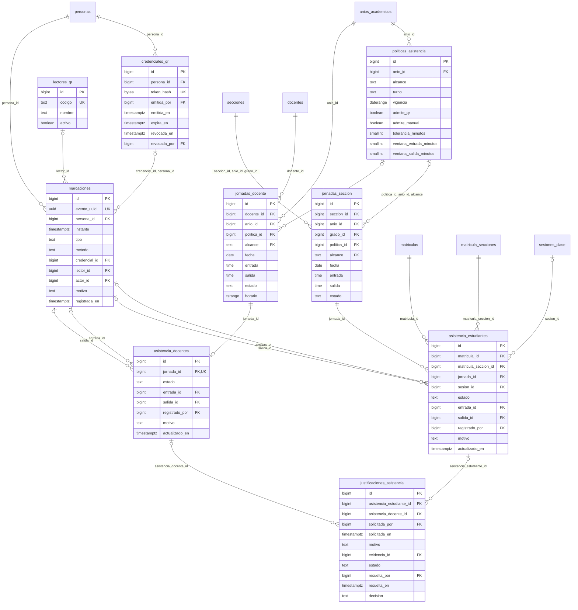

<!-- Archivo generado por scripts/db/generar-docs.mjs a partir del catálogo real. No editar a mano. -->

# Asistencia de alumnos y docentes

Tablas (9): [`politicas_asistencia`](#politicas_asistencia), [`jornadas_seccion`](#jornadas_seccion), [`jornadas_docente`](#jornadas_docente), [`lectores_qr`](#lectores_qr), [`credenciales_qr`](#credenciales_qr), [`marcaciones`](#marcaciones), [`asistencia_estudiantes`](#asistencia_estudiantes), [`asistencia_docentes`](#asistencia_docentes), [`justificaciones_asistencia`](#justificaciones_asistencia).

## Diagrama ER

> Para legibilidad se omiten las referencias de auditoría/evidencia hacia `usuarios` y `archivos` cuando esas tablas no pertenecen al diagrama; sí figuran en el diccionario.

## Diccionario

### politicas_asistencia

Política por año, alcance (alumno/docente) y turno: admite QR/manual, tolerancia y ventanas de entrada/salida.

| Columna | Tipo | Nulo | Defecto / generada | Clave / referencia |
|---|---|---|---|---|
| `id` | bigint | no | identity (always) | PK |
| `anio_id` | bigint | no |  | → [`anios_academicos`](03-academico-evaluacion.md#anios_academicos).id |
| `alcance` | text | no |  |  |
| `turno` | text | no |  |  |
| `vigencia` | daterange | no |  |  |
| `admite_qr` | boolean | no | `true` |  |
| `admite_manual` | boolean | no | `true` |  |
| `tolerancia_minutos` | smallint | no | `0` |  |
| `ventana_entrada_minutos` | smallint | no | `60` |  |
| `ventana_salida_minutos` | smallint | no | `60` |  |

**Restricciones**

- **PK** (id)
- **UNIQUE** (id, anio_id, alcance) — `politicas_asistencia_id_anio_id_alcance_key`
- **CHECK** `politicas_asistencia_alcance_check`: `((alcance = ANY (ARRAY['alumno', 'docente'])))`
- **CHECK** `politicas_asistencia_check`: `((admite_qr OR admite_manual))`
- **CHECK** `politicas_asistencia_tolerancia_minutos_check`: `(((tolerancia_minutos >= 0) AND (tolerancia_minutos <= 120)))`
- **CHECK** `politicas_asistencia_turno_check`: `((btrim(turno) <> ''))`
- **CHECK** `politicas_asistencia_ventana_entrada_minutos_check`: `(((ventana_entrada_minutos >= 0) AND (ventana_entrada_minutos <= 720)))`
- **CHECK** `politicas_asistencia_ventana_salida_minutos_check`: `(((ventana_salida_minutos >= 0) AND (ventana_salida_minutos <= 720)))`
- **CHECK** `politicas_asistencia_vigencia_check`: `(((NOT isempty(vigencia)) AND (NOT lower_inf(vigencia)) AND (NOT upper_inf(vigencia))))`
- **EXCLUDE** `politicas_asistencia_anio_id_alcance_turno_vigencia_excl`: `USING gist (anio_id WITH =, alcance WITH =, turno WITH =, vigencia WITH &&)`

### jornadas_seccion

Jornada diaria de una sección (una por fecha) con su política.

| Columna | Tipo | Nulo | Defecto / generada | Clave / referencia |
|---|---|---|---|---|
| `id` | bigint | no | identity (always) | PK |
| `seccion_id` | bigint | no |  | → [`secciones`](03-academico-evaluacion.md#secciones) (FK compuesta) |
| `anio_id` | bigint | no |  | → [`politicas_asistencia`](04-asistencia.md#politicas_asistencia) (FK compuesta) · → [`secciones`](03-academico-evaluacion.md#secciones) (FK compuesta) |
| `grado_id` | bigint | no |  | → [`secciones`](03-academico-evaluacion.md#secciones) (FK compuesta) |
| `politica_id` | bigint | no |  | → [`politicas_asistencia`](04-asistencia.md#politicas_asistencia) (FK compuesta) |
| `alcance` | text | sí | generada: `'alumno'` | → [`politicas_asistencia`](04-asistencia.md#politicas_asistencia) (FK compuesta) |
| `fecha` | date | no |  |  |
| `entrada` | time | no |  |  |
| `salida` | time | no |  |  |
| `estado` | text | no | `'programada'` |  |

**Restricciones**

- **PK** (id)
- **UNIQUE** (seccion_id, fecha) — `jornadas_seccion_seccion_id_fecha_key`
- **FK** (politica_id, anio_id, alcance) → [`politicas_asistencia`](04-asistencia.md#politicas_asistencia) (id, anio_id, alcance)
- **FK** (seccion_id, anio_id, grado_id) → [`secciones`](03-academico-evaluacion.md#secciones) (id, anio_id, grado_id)
- **CHECK** `jornadas_seccion_check`: `((entrada < salida))`
- **CHECK** `jornadas_seccion_estado_check`: `((estado = ANY (ARRAY['programada', 'cancelada'])))`

**Triggers**

- `controlar_jornada_seccion` — BEFORE INSERT OR UPDATE → [`validar_fecha_jornada()`](../funciones.md#validar_fecha_jornada)

### jornadas_docente

Jornada diaria de un docente (sin solapes de horario) con su política.

| Columna | Tipo | Nulo | Defecto / generada | Clave / referencia |
|---|---|---|---|---|
| `id` | bigint | no | identity (always) | PK |
| `docente_id` | bigint | no |  | → [`docentes`](06-personal-planilla.md#docentes).id |
| `anio_id` | bigint | no |  | → [`anios_academicos`](03-academico-evaluacion.md#anios_academicos).id · → [`politicas_asistencia`](04-asistencia.md#politicas_asistencia) (FK compuesta) |
| `politica_id` | bigint | no |  | → [`politicas_asistencia`](04-asistencia.md#politicas_asistencia) (FK compuesta) |
| `alcance` | text | sí | generada: `'docente'` | → [`politicas_asistencia`](04-asistencia.md#politicas_asistencia) (FK compuesta) |
| `fecha` | date | no |  |  |
| `entrada` | time | no |  |  |
| `salida` | time | no |  |  |
| `estado` | text | no | `'programada'` |  |
| `horario` | tsrange | sí | generada: `tsrange((fecha + entrada), (fecha + salida), '[)')` |  |

**Restricciones**

- **PK** (id)
- **FK** (politica_id, anio_id, alcance) → [`politicas_asistencia`](04-asistencia.md#politicas_asistencia) (id, anio_id, alcance)
- **CHECK** `jornadas_docente_check`: `((entrada < salida))`
- **CHECK** `jornadas_docente_estado_check`: `((estado = ANY (ARRAY['programada', 'cancelada'])))`
- **EXCLUDE** `jornadas_docente_docente_id_horario_excl`: `USING gist (docente_id WITH =, horario WITH &&) WHERE ((estado = 'programada'))`

**Triggers**

- `controlar_jornada_docente` — BEFORE INSERT OR UPDATE → [`validar_fecha_jornada()`](../funciones.md#validar_fecha_jornada)

### lectores_qr

Puntos o dispositivos de lectura habilitados.

| Columna | Tipo | Nulo | Defecto / generada | Clave / referencia |
|---|---|---|---|---|
| `id` | bigint | no | identity (always) | PK |
| `codigo` | text | no |  | UNIQUE |
| `nombre` | text | no |  |  |
| `activo` | boolean | no | `true` |  |

**Restricciones**

- **PK** (id)
- **UNIQUE** (codigo) — `lectores_qr_codigo_key`

### credenciales_qr

Credenciales QR por persona: SHA-256 del token (32 bytes), expiración y revocación.

| Columna | Tipo | Nulo | Defecto / generada | Clave / referencia |
|---|---|---|---|---|
| `id` | bigint | no | identity (always) | PK |
| `persona_id` | bigint | no |  | → [`personas`](01-identidad-permisos.md#personas).id |
| `token_hash` | bytea | no |  | UNIQUE |
| `emitida_por` | bigint | no |  | → [`usuarios`](01-identidad-permisos.md#usuarios).id |
| `emitida_en` | timestamptz | no | `now()` |  |
| `expira_en` | timestamptz | no |  |  |
| `revocada_en` | timestamptz | sí |  |  |
| `revocada_por` | bigint | sí |  | → [`usuarios`](01-identidad-permisos.md#usuarios).id |

**Restricciones**

- **PK** (id)
- **UNIQUE** (id, persona_id) — `credenciales_qr_id_persona_id_key`
- **UNIQUE** (token_hash) — `credenciales_qr_token_hash_key`
- **CHECK** `credenciales_qr_check`: `((expira_en > emitida_en))`
- **CHECK** `credenciales_qr_check1`: `(((revocada_en IS NULL) = (revocada_por IS NULL)))`
- **CHECK** `credenciales_qr_check2`: `((revocada_en >= emitida_en))`
- **CHECK** `credenciales_qr_token_hash_check`: `((octet_length(token_hash) = 32))`

**Índices adicionales**

- `credenciales_qr_persona_idx`: `USING btree (persona_id)`

### marcaciones

Eventos de entrada/salida (QR o manual), idempotentes por evento_uuid. Solo inserción.

| Columna | Tipo | Nulo | Defecto / generada | Clave / referencia |
|---|---|---|---|---|
| `id` | bigint | no | identity (always) | PK |
| `evento_uuid` | uuid | no |  | UNIQUE |
| `persona_id` | bigint | no |  | → [`credenciales_qr`](04-asistencia.md#credenciales_qr) (FK compuesta) · → [`personas`](01-identidad-permisos.md#personas).id |
| `instante` | timestamptz | no |  |  |
| `tipo` | text | no |  |  |
| `metodo` | text | no |  |  |
| `credencial_id` | bigint | sí |  | → [`credenciales_qr`](04-asistencia.md#credenciales_qr) (FK compuesta) |
| `lector_id` | bigint | sí |  | → [`lectores_qr`](04-asistencia.md#lectores_qr).id |
| `actor_id` | bigint | no |  | → [`usuarios`](01-identidad-permisos.md#usuarios).id |
| `motivo` | text | sí |  |  |
| `registrada_en` | timestamptz | no | `clock_timestamp()` |  |

**Restricciones**

- **PK** (id)
- **UNIQUE** (evento_uuid) — `marcaciones_evento_uuid_key`
- **FK** (credencial_id, persona_id) → [`credenciales_qr`](04-asistencia.md#credenciales_qr) (id, persona_id)
- **CHECK** `marcaciones_check`: `((instante <= registrada_en))`
- **CHECK** `marcaciones_check1`: `((((metodo = 'qr') AND (credencial_id IS NOT NULL) AND (lector_id IS NOT NULL) AND (motivo IS NULL)) OR ((metodo = 'manual') AND (credencial_id IS NULL) AND (lector_id IS NULL) AND (motivo IS NOT NULL) AND (btrim(motivo) <> ''))))`
- **CHECK** `marcaciones_metodo_check`: `((metodo = ANY (ARRAY['qr', 'manual'])))`
- **CHECK** `marcaciones_tipo_check`: `((tipo = ANY (ARRAY['entrada', 'salida'])))`

**Índices adicionales**

- `marcaciones_persona_instante_idx`: `USING btree (persona_id, instante)`

**Triggers**

- `conservar_marcaciones` — BEFORE DELETE OR UPDATE → [`conservar_evento_asistencia()`](../funciones.md#conservar_evento_asistencia)

### asistencia_estudiantes

Estado de asistencia del alumno por jornada (diaria) o por sesión de clase, vinculado a marcaciones.

| Columna | Tipo | Nulo | Defecto / generada | Clave / referencia |
|---|---|---|---|---|
| `id` | bigint | no | identity (always) | PK |
| `matricula_id` | bigint | no |  | → [`matriculas`](02-matricula.md#matriculas).id |
| `matricula_seccion_id` | bigint | no |  | → [`matricula_secciones`](02-matricula.md#matricula_secciones).id |
| `jornada_id` | bigint | no |  | → [`jornadas_seccion`](04-asistencia.md#jornadas_seccion).id |
| `sesion_id` | bigint | sí |  | → [`sesiones_clase`](03-academico-evaluacion.md#sesiones_clase).id |
| `estado` | text | no | `'pendiente'` |  |
| `entrada_id` | bigint | sí |  | → [`marcaciones`](04-asistencia.md#marcaciones).id |
| `salida_id` | bigint | sí |  | → [`marcaciones`](04-asistencia.md#marcaciones).id |
| `registrado_por` | bigint | no |  | → [`usuarios`](01-identidad-permisos.md#usuarios).id |
| `motivo` | text | no |  |  |
| `actualizado_en` | timestamptz | no | `clock_timestamp()` |  |

**Restricciones**

- **PK** (id)
- **CHECK** `asistencia_estudiantes_check`: `(((sesion_id IS NULL) OR ((entrada_id IS NULL) AND (salida_id IS NULL))))`
- **CHECK** `asistencia_estudiantes_estado_check`: `((estado = ANY (ARRAY['pendiente', 'presente', 'tarde', 'ausente', 'justificado'])))`
- **CHECK** `asistencia_estudiantes_motivo_check`: `((btrim(motivo) <> ''))`

**Índices adicionales**

- `asistencia_estudiante_diaria_unica`: `UNIQUE USING btree (matricula_id, jornada_id) WHERE (sesion_id IS NULL)`
- `asistencia_estudiante_entrada_unica`: `UNIQUE USING btree (entrada_id) WHERE (entrada_id IS NOT NULL)`
- `asistencia_estudiante_salida_unica`: `UNIQUE USING btree (salida_id) WHERE (salida_id IS NOT NULL)`
- `asistencia_estudiante_sesion_unica`: `UNIQUE USING btree (matricula_id, sesion_id) WHERE (sesion_id IS NOT NULL)`

**Triggers**

- `auditar_asistencia_estudiante` — AFTER INSERT OR UPDATE → [`auditar_asistencia()`](../funciones.md#auditar_asistencia)
- `conservar_asistencia_estudiante` — BEFORE DELETE → [`conservar_evento_asistencia()`](../funciones.md#conservar_evento_asistencia)
- `controlar_asistencia_estudiante` — BEFORE INSERT OR UPDATE → [`validar_asistencia()`](../funciones.md#validar_asistencia)

### asistencia_docentes

Estado de asistencia del docente por jornada (una por jornada).

| Columna | Tipo | Nulo | Defecto / generada | Clave / referencia |
|---|---|---|---|---|
| `id` | bigint | no | identity (always) | PK |
| `jornada_id` | bigint | no |  | → [`jornadas_docente`](04-asistencia.md#jornadas_docente).id · UNIQUE |
| `estado` | text | no | `'pendiente'` |  |
| `entrada_id` | bigint | sí |  | → [`marcaciones`](04-asistencia.md#marcaciones).id |
| `salida_id` | bigint | sí |  | → [`marcaciones`](04-asistencia.md#marcaciones).id |
| `registrado_por` | bigint | no |  | → [`usuarios`](01-identidad-permisos.md#usuarios).id |
| `motivo` | text | no |  |  |
| `actualizado_en` | timestamptz | no | `clock_timestamp()` |  |

**Restricciones**

- **PK** (id)
- **UNIQUE** (jornada_id) — `asistencia_docentes_jornada_id_key`
- **CHECK** `asistencia_docentes_estado_check`: `((estado = ANY (ARRAY['pendiente', 'presente', 'tarde', 'ausente', 'justificado'])))`
- **CHECK** `asistencia_docentes_motivo_check`: `((btrim(motivo) <> ''))`

**Índices adicionales**

- `asistencia_docente_entrada_unica`: `UNIQUE USING btree (entrada_id) WHERE (entrada_id IS NOT NULL)`
- `asistencia_docente_salida_unica`: `UNIQUE USING btree (salida_id) WHERE (salida_id IS NOT NULL)`

**Triggers**

- `auditar_asistencia_docente` — AFTER INSERT OR UPDATE → [`auditar_asistencia()`](../funciones.md#auditar_asistencia)
- `conservar_asistencia_docente` — BEFORE DELETE → [`conservar_evento_asistencia()`](../funciones.md#conservar_evento_asistencia)
- `controlar_asistencia_docente` — BEFORE INSERT OR UPDATE → [`validar_asistencia()`](../funciones.md#validar_asistencia)

### justificaciones_asistencia

Solicitudes de justificación (alumno o docente) con resolución; al aprobarse marcan la asistencia como justificada.

| Columna | Tipo | Nulo | Defecto / generada | Clave / referencia |
|---|---|---|---|---|
| `id` | bigint | no | identity (always) | PK |
| `asistencia_estudiante_id` | bigint | sí |  | → [`asistencia_estudiantes`](04-asistencia.md#asistencia_estudiantes).id |
| `asistencia_docente_id` | bigint | sí |  | → [`asistencia_docentes`](04-asistencia.md#asistencia_docentes).id |
| `solicitada_por` | bigint | no |  | → [`usuarios`](01-identidad-permisos.md#usuarios).id |
| `solicitada_en` | timestamptz | no | `clock_timestamp()` |  |
| `motivo` | text | no |  |  |
| `evidencia_id` | bigint | sí |  | → [`archivos`](07-documentos-reportes.md#archivos).id |
| `estado` | text | no | `'pendiente'` |  |
| `resuelta_por` | bigint | sí |  | → [`usuarios`](01-identidad-permisos.md#usuarios).id |
| `resuelta_en` | timestamptz | sí |  |  |
| `decision` | text | sí |  |  |

**Restricciones**

- **PK** (id)
- **CHECK** `justificaciones_asistencia_check`: `((num_nonnulls(asistencia_estudiante_id, asistencia_docente_id) = 1))`
- **CHECK** `justificaciones_asistencia_check1`: `((((estado = 'pendiente') AND (num_nonnulls(resuelta_por, resuelta_en, decision) = 0)) OR ((estado <> 'pendiente') AND (resuelta_por IS NOT NULL) AND (resuelta_en IS NOT NULL) AND (resuelta_en >= solicitada_en) AND (decision IS NOT NULL) AND (btrim(decision) <> ''))))`
- **CHECK** `justificaciones_asistencia_estado_check`: `((estado = ANY (ARRAY['pendiente', 'aprobada', 'rechazada'])))`
- **CHECK** `justificaciones_asistencia_motivo_check`: `((btrim(motivo) <> ''))`

**Índices adicionales**

- `justificacion_docente_vigente`: `UNIQUE USING btree (asistencia_docente_id) WHERE (estado = ANY (ARRAY['pendiente', 'aprobada']))`
- `justificacion_estudiante_vigente`: `UNIQUE USING btree (asistencia_estudiante_id) WHERE (estado = ANY (ARRAY['pendiente', 'aprobada']))`

**Triggers**

- `aplicar_justificacion` — AFTER INSERT OR UPDATE → [`aplicar_justificacion()`](../funciones.md#aplicar_justificacion)
- `conservar_justificacion` — BEFORE DELETE → [`conservar_evento_asistencia()`](../funciones.md#conservar_evento_asistencia)
- `controlar_justificacion` — BEFORE INSERT OR UPDATE → [`validar_justificacion()`](../funciones.md#validar_justificacion)
