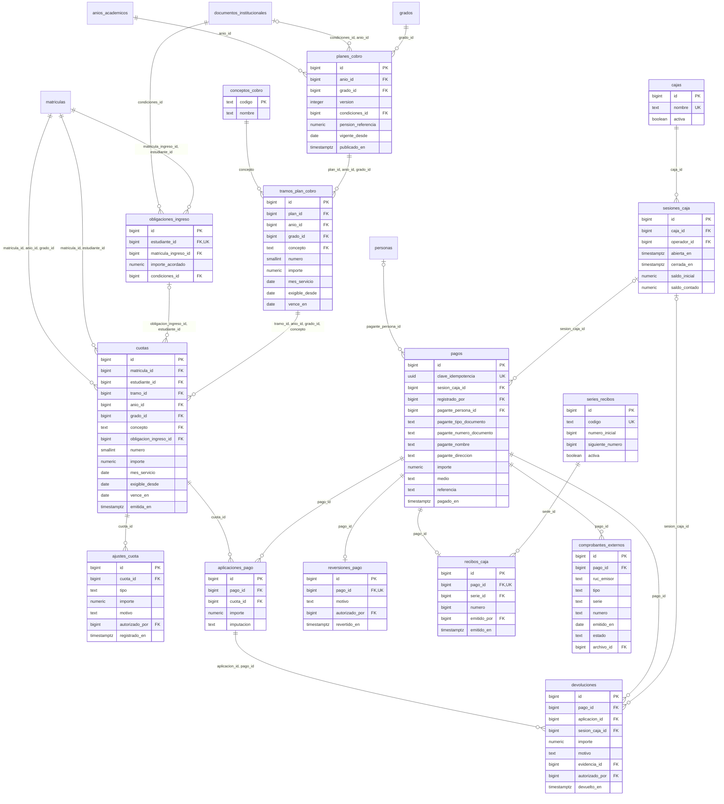

<!-- Archivo generado por scripts/db/generar-docs.mjs a partir del catálogo real. No editar a mano. -->

# Cobros, caja y tesorería

Tablas (15): [`conceptos_cobro`](#conceptos_cobro), [`planes_cobro`](#planes_cobro), [`tramos_plan_cobro`](#tramos_plan_cobro), [`obligaciones_ingreso`](#obligaciones_ingreso), [`cuotas`](#cuotas), [`ajustes_cuota`](#ajustes_cuota), [`pagos`](#pagos), [`aplicaciones_pago`](#aplicaciones_pago), [`devoluciones`](#devoluciones), [`reversiones_pago`](#reversiones_pago), [`recibos_caja`](#recibos_caja), [`series_recibos`](#series_recibos), [`cajas`](#cajas), [`sesiones_caja`](#sesiones_caja), [`comprobantes_externos`](#comprobantes_externos).

## Diagrama ER

> Para legibilidad se omiten las referencias de auditoría/evidencia hacia `usuarios` y `archivos` cuando esas tablas no pertenecen al diagrama; sí figuran en el diccionario.

## Diccionario

### conceptos_cobro

Conceptos: ingreso, matrícula, pensión.

Filas sembradas en el dump: **3**.

| Columna | Tipo | Nulo | Defecto / generada | Clave / referencia |
|---|---|---|---|---|
| `codigo` | text | no |  | PK |
| `nombre` | text | no |  |  |

**Restricciones**

- **PK** (codigo)
- **CHECK** `conceptos_cobro_codigo_check`: `((codigo = ANY (ARRAY['ingreso', 'matricula', 'pension'])))`

### planes_cobro

Plan de cobro versionado por año y grado; pensión de referencia; se publica con sus condiciones económicas.

| Columna | Tipo | Nulo | Defecto / generada | Clave / referencia |
|---|---|---|---|---|
| `id` | bigint | no | identity (always) | PK |
| `anio_id` | bigint | no |  | → [`anios_academicos`](03-academico-evaluacion.md#anios_academicos).id · → [`documentos_institucionales`](02-matricula.md#documentos_institucionales) (FK compuesta) |
| `grado_id` | bigint | no |  | → [`grados`](03-academico-evaluacion.md#grados).id |
| `version` | integer | no |  |  |
| `condiciones_id` | bigint | sí |  | → [`documentos_institucionales`](02-matricula.md#documentos_institucionales) (FK compuesta) |
| `pension_referencia` | numeric(12,2) | sí |  |  |
| `vigente_desde` | date | sí |  |  |
| `publicado_en` | timestamptz | sí |  |  |

**Restricciones**

- **PK** (id)
- **UNIQUE** (anio_id, grado_id, version) — `planes_cobro_anio_id_grado_id_version_key`
- **UNIQUE** (id, anio_id, grado_id) — `planes_cobro_id_anio_id_grado_id_key`
- **FK** (condiciones_id, anio_id) → [`documentos_institucionales`](02-matricula.md#documentos_institucionales) (id, anio_id)
- **CHECK** `planes_cobro_check`: `(((publicado_en IS NULL) OR ((condiciones_id IS NOT NULL) AND (pension_referencia IS NOT NULL) AND (vigente_desde IS NOT NULL))))`
- **CHECK** `planes_cobro_pension_referencia_check`: `((pension_referencia > (0)))`
- **CHECK** `planes_cobro_version_check`: `((version > 0))`

### tramos_plan_cobro

Cronograma del plan: concepto, número, importe, mes de servicio, exigibilidad y vencimiento.

| Columna | Tipo | Nulo | Defecto / generada | Clave / referencia |
|---|---|---|---|---|
| `id` | bigint | no | identity (always) | PK |
| `plan_id` | bigint | no |  | → [`planes_cobro`](05-cobros.md#planes_cobro) (FK compuesta) |
| `anio_id` | bigint | no |  | → [`planes_cobro`](05-cobros.md#planes_cobro) (FK compuesta) |
| `grado_id` | bigint | no |  | → [`planes_cobro`](05-cobros.md#planes_cobro) (FK compuesta) |
| `concepto` | text | no |  | → [`conceptos_cobro`](05-cobros.md#conceptos_cobro).codigo |
| `numero` | smallint | no |  |  |
| `importe` | numeric(12,2) | no |  |  |
| `mes_servicio` | date | sí |  |  |
| `exigible_desde` | date | no |  |  |
| `vence_en` | date | no |  |  |

**Restricciones**

- **PK** (id)
- **UNIQUE** (id, anio_id, grado_id, concepto) — `tramos_plan_cobro_id_anio_id_grado_id_concepto_key`
- **UNIQUE** (plan_id, concepto, numero) — `tramos_plan_cobro_plan_id_concepto_numero_key`
- **UNIQUE** (plan_id, mes_servicio) — `tramos_plan_cobro_plan_id_mes_servicio_key`
- **FK** (plan_id, anio_id, grado_id) → [`planes_cobro`](05-cobros.md#planes_cobro) (id, anio_id, grado_id)
- **CHECK** `tramos_plan_cobro_check`: `(((concepto <> 'matricula') OR (numero = 1)))`
- **CHECK** `tramos_plan_cobro_check1`: `((vence_en >= exigible_desde))`
- **CHECK** `tramos_plan_cobro_check2`: `(((concepto = 'pension') = (mes_servicio IS NOT NULL)))`
- **CHECK** `tramos_plan_cobro_check3`: `(((mes_servicio IS NULL) OR ((EXTRACT(day FROM mes_servicio) = (1)) AND (exigible_desde >= (((mes_servicio + '1 mon'::interval))::date - 1)))))`
- **CHECK** `tramos_plan_cobro_importe_check`: `((importe >= (0)))`
- **CHECK** `tramos_plan_cobro_numero_check`: `((numero > 0))`

### obligaciones_ingreso

Cuota de ingreso acordada por alumno (una por alumno, ligada a la matrícula de ingreso).

| Columna | Tipo | Nulo | Defecto / generada | Clave / referencia |
|---|---|---|---|---|
| `id` | bigint | no | identity (always) | PK |
| `estudiante_id` | bigint | no |  | → [`matriculas`](02-matricula.md#matriculas) (FK compuesta) · UNIQUE |
| `matricula_ingreso_id` | bigint | no |  | → [`matriculas`](02-matricula.md#matriculas) (FK compuesta) |
| `importe_acordado` | numeric(12,2) | no |  |  |
| `condiciones_id` | bigint | no |  | → [`documentos_institucionales`](02-matricula.md#documentos_institucionales).id |

**Restricciones**

- **PK** (id)
- **UNIQUE** (estudiante_id) — `obligaciones_ingreso_estudiante_id_key`
- **UNIQUE** (id, estudiante_id) — `obligaciones_ingreso_id_estudiante_id_key`
- **FK** (matricula_ingreso_id, estudiante_id) → [`matriculas`](02-matricula.md#matriculas) (id, estudiante_id)
- **CHECK** `obligaciones_ingreso_importe_acordado_check`: `((importe_acordado >= (0)))`

### cuotas

Cuotas emitidas para una matrícula activa replicando un tramo publicado. Inmutables.

| Columna | Tipo | Nulo | Defecto / generada | Clave / referencia |
|---|---|---|---|---|
| `id` | bigint | no | identity (always) | PK |
| `matricula_id` | bigint | no |  | → [`matriculas`](02-matricula.md#matriculas) (FK compuesta) |
| `estudiante_id` | bigint | no |  | → [`matriculas`](02-matricula.md#matriculas) (FK compuesta) · → [`obligaciones_ingreso`](05-cobros.md#obligaciones_ingreso) (FK compuesta) |
| `tramo_id` | bigint | no |  | → [`tramos_plan_cobro`](05-cobros.md#tramos_plan_cobro) (FK compuesta) |
| `anio_id` | bigint | no |  | → [`matriculas`](02-matricula.md#matriculas) (FK compuesta) · → [`tramos_plan_cobro`](05-cobros.md#tramos_plan_cobro) (FK compuesta) |
| `grado_id` | bigint | no |  | → [`matriculas`](02-matricula.md#matriculas) (FK compuesta) · → [`tramos_plan_cobro`](05-cobros.md#tramos_plan_cobro) (FK compuesta) |
| `concepto` | text | no |  | → [`tramos_plan_cobro`](05-cobros.md#tramos_plan_cobro) (FK compuesta) |
| `obligacion_ingreso_id` | bigint | sí |  | → [`obligaciones_ingreso`](05-cobros.md#obligaciones_ingreso) (FK compuesta) |
| `numero` | smallint | no |  |  |
| `importe` | numeric(12,2) | no |  |  |
| `mes_servicio` | date | sí |  |  |
| `exigible_desde` | date | no |  |  |
| `vence_en` | date | no |  |  |
| `emitida_en` | timestamptz | no | `now()` |  |

**Restricciones**

- **PK** (id)
- **UNIQUE** (matricula_id, concepto, numero) — `cuotas_matricula_id_concepto_numero_key`
- **UNIQUE** (matricula_id, mes_servicio) — `cuotas_matricula_id_mes_servicio_key`
- **UNIQUE** (obligacion_ingreso_id, numero) — `cuotas_obligacion_ingreso_id_numero_key`
- **FK** (matricula_id, anio_id, grado_id) → [`matriculas`](02-matricula.md#matriculas) (id, anio_id, grado_id)
- **FK** (matricula_id, estudiante_id) → [`matriculas`](02-matricula.md#matriculas) (id, estudiante_id)
- **FK** (obligacion_ingreso_id, estudiante_id) → [`obligaciones_ingreso`](05-cobros.md#obligaciones_ingreso) (id, estudiante_id)
- **FK** (tramo_id, anio_id, grado_id, concepto) → [`tramos_plan_cobro`](05-cobros.md#tramos_plan_cobro) (id, anio_id, grado_id, concepto)
- **CHECK** `cuotas_check`: `(((concepto = 'ingreso') = (obligacion_ingreso_id IS NOT NULL)))`
- **CHECK** `cuotas_check1`: `(((concepto <> 'matricula') OR (numero = 1)))`
- **CHECK** `cuotas_check2`: `((vence_en >= exigible_desde))`
- **CHECK** `cuotas_check3`: `(((concepto = 'pension') = (mes_servicio IS NOT NULL)))`
- **CHECK** `cuotas_check4`: `(((mes_servicio IS NULL) OR ((EXTRACT(day FROM mes_servicio) = (1)) AND (exigible_desde >= (((mes_servicio + '1 mon'::interval))::date - 1)))))`
- **CHECK** `cuotas_importe_check`: `((importe >= (0)))`
- **CHECK** `cuotas_numero_check`: `((numero > 0))`

**Índices adicionales**

- `cuotas_vencimiento_idx`: `USING btree (vence_en, matricula_id)`

**Triggers**

- `controlar_emision` — BEFORE INSERT → [`validar_emision_cuota()`](../funciones.md#validar_emision_cuota)
- `preservar_cuota` — BEFORE DELETE OR UPDATE → [`preservar_registro_financiero()`](../funciones.md#preservar_registro_financiero)

### ajustes_cuota

Descuentos, exoneraciones (negativos) o correcciones de una cuota.

| Columna | Tipo | Nulo | Defecto / generada | Clave / referencia |
|---|---|---|---|---|
| `id` | bigint | no | identity (always) | PK |
| `cuota_id` | bigint | no |  | → [`cuotas`](05-cobros.md#cuotas).id |
| `tipo` | text | no |  |  |
| `importe` | numeric(12,2) | no |  |  |
| `motivo` | text | no |  |  |
| `autorizado_por` | bigint | no |  | → [`usuarios`](01-identidad-permisos.md#usuarios).id |
| `registrado_en` | timestamptz | no | `now()` |  |

**Restricciones**

- **PK** (id)
- **CHECK** `ajustes_cuota_check`: `(((tipo = 'correccion') OR (importe < (0))))`
- **CHECK** `ajustes_cuota_importe_check`: `((importe <> (0)))`
- **CHECK** `ajustes_cuota_tipo_check`: `((tipo = ANY (ARRAY['descuento', 'exoneracion', 'correccion'])))`

**Índices adicionales**

- `ajustes_cuota_cuota_idx`: `USING btree (cuota_id)`

### pagos

Pago recibido, idempotente por clave_idempotencia; pagante, medio y sesión de caja (obligatoria en efectivo). Inmutable.

| Columna | Tipo | Nulo | Defecto / generada | Clave / referencia |
|---|---|---|---|---|
| `id` | bigint | no | identity (always) | PK |
| `clave_idempotencia` | uuid | no |  | UNIQUE |
| `sesion_caja_id` | bigint | sí |  | → [`sesiones_caja`](05-cobros.md#sesiones_caja).id |
| `registrado_por` | bigint | no |  | → [`usuarios`](01-identidad-permisos.md#usuarios).id |
| `pagante_persona_id` | bigint | sí |  | → [`personas`](01-identidad-permisos.md#personas).id |
| `pagante_tipo_documento` | text | sí |  |  |
| `pagante_numero_documento` | text | sí |  |  |
| `pagante_nombre` | text | no |  |  |
| `pagante_direccion` | text | sí |  |  |
| `importe` | numeric(12,2) | no |  |  |
| `medio` | text | no |  |  |
| `referencia` | text | sí |  |  |
| `pagado_en` | timestamptz | no | `now()` |  |

**Restricciones**

- **PK** (id)
- **UNIQUE** (clave_idempotencia) — `pagos_clave_idempotencia_key`
- **CHECK** `pagos_check`: `(((medio <> 'efectivo') OR (sesion_caja_id IS NOT NULL)))`
- **CHECK** `pagos_importe_check`: `((importe > (0)))`
- **CHECK** `pagos_medio_check`: `((medio = ANY (ARRAY['efectivo', 'transferencia', 'tarjeta', 'otro'])))`

**Triggers**

- `preservar_pago` — BEFORE DELETE OR UPDATE → [`preservar_registro_financiero()`](../funciones.md#preservar_registro_financiero)

### aplicaciones_pago

Imputación de un pago a cuotas (por elección del pagante o por regla). Inmutable.

| Columna | Tipo | Nulo | Defecto / generada | Clave / referencia |
|---|---|---|---|---|
| `id` | bigint | no | identity (always) | PK |
| `pago_id` | bigint | no |  | → [`pagos`](05-cobros.md#pagos).id |
| `cuota_id` | bigint | no |  | → [`cuotas`](05-cobros.md#cuotas).id |
| `importe` | numeric(12,2) | no |  |  |
| `imputacion` | text | no |  |  |

**Restricciones**

- **PK** (id)
- **UNIQUE** (id, pago_id) — `aplicaciones_pago_id_pago_id_key`
- **UNIQUE** (pago_id, cuota_id) — `aplicaciones_pago_pago_id_cuota_id_key`
- **CHECK** `aplicaciones_pago_importe_check`: `((importe > (0)))`
- **CHECK** `aplicaciones_pago_imputacion_check`: `((imputacion = ANY (ARRAY['eleccion_pagante', 'regla'])))`

**Índices adicionales**

- `aplicaciones_pago_cuota_idx`: `USING btree (cuota_id)`

**Triggers**

- `controlar_abono` — BEFORE INSERT → [`validar_aplicacion_pago()`](../funciones.md#validar_aplicacion_pago)
- `preservar_aplicacion` — BEFORE DELETE OR UPDATE → [`preservar_registro_financiero()`](../funciones.md#preservar_registro_financiero)

### devoluciones

Devoluciones de una aplicación de pago.

| Columna | Tipo | Nulo | Defecto / generada | Clave / referencia |
|---|---|---|---|---|
| `id` | bigint | no | identity (always) | PK |
| `pago_id` | bigint | no |  | → [`aplicaciones_pago`](05-cobros.md#aplicaciones_pago) (FK compuesta) · → [`pagos`](05-cobros.md#pagos).id |
| `aplicacion_id` | bigint | no |  | → [`aplicaciones_pago`](05-cobros.md#aplicaciones_pago) (FK compuesta) |
| `sesion_caja_id` | bigint | sí |  | → [`sesiones_caja`](05-cobros.md#sesiones_caja).id |
| `importe` | numeric(12,2) | no |  |  |
| `motivo` | text | no |  |  |
| `evidencia_id` | bigint | sí |  | → [`archivos`](07-documentos-reportes.md#archivos).id |
| `autorizado_por` | bigint | no |  | → [`usuarios`](01-identidad-permisos.md#usuarios).id |
| `devuelto_en` | timestamptz | no | `now()` |  |

**Restricciones**

- **PK** (id)
- **FK** (aplicacion_id, pago_id) → [`aplicaciones_pago`](05-cobros.md#aplicaciones_pago) (id, pago_id)
- **CHECK** `devoluciones_importe_check`: `((importe > (0)))`

**Índices adicionales**

- `devoluciones_aplicacion_idx`: `USING btree (aplicacion_id)`

### reversiones_pago

Reversión total de un pago (una por pago).

| Columna | Tipo | Nulo | Defecto / generada | Clave / referencia |
|---|---|---|---|---|
| `id` | bigint | no | identity (always) | PK |
| `pago_id` | bigint | no |  | → [`pagos`](05-cobros.md#pagos).id · UNIQUE |
| `motivo` | text | no |  |  |
| `autorizado_por` | bigint | no |  | → [`usuarios`](01-identidad-permisos.md#usuarios).id |
| `revertido_en` | timestamptz | no | `now()` |  |

**Restricciones**

- **PK** (id)
- **UNIQUE** (pago_id) — `reversiones_pago_pago_id_key`

### recibos_caja

Recibo interno numerado por serie para un pago totalmente aplicado. Inmutable.

| Columna | Tipo | Nulo | Defecto / generada | Clave / referencia |
|---|---|---|---|---|
| `id` | bigint | no | identity (always) | PK |
| `pago_id` | bigint | no |  | → [`pagos`](05-cobros.md#pagos).id · UNIQUE |
| `serie_id` | bigint | no |  | → [`series_recibos`](05-cobros.md#series_recibos).id |
| `numero` | bigint | no |  |  |
| `emitido_por` | bigint | no |  | → [`usuarios`](01-identidad-permisos.md#usuarios).id |
| `emitido_en` | timestamptz | no | `now()` |  |

**Restricciones**

- **PK** (id)
- **UNIQUE** (pago_id) — `recibos_caja_pago_id_key`
- **UNIQUE** (serie_id, numero) — `recibos_caja_serie_id_numero_key`
- **CHECK** `recibos_caja_numero_check`: `((numero > 0))`

**Triggers**

- `preservar_recibo` — BEFORE DELETE OR UPDATE → [`preservar_registro_financiero()`](../funciones.md#preservar_registro_financiero)

### series_recibos

Series de numeración de recibos (REC-XXX).

| Columna | Tipo | Nulo | Defecto / generada | Clave / referencia |
|---|---|---|---|---|
| `id` | bigint | no | identity (always) | PK |
| `codigo` | text | no |  | UNIQUE |
| `numero_inicial` | bigint | no |  |  |
| `siguiente_numero` | bigint | no |  |  |
| `activa` | boolean | no | `true` |  |

**Restricciones**

- **PK** (id)
- **UNIQUE** (codigo) — `series_recibos_codigo_key`
- **CHECK** `series_recibos_check`: `((siguiente_numero >= numero_inicial))`
- **CHECK** `series_recibos_codigo_check`: `((codigo ~ '^REC-[A-Z0-9]+$'))`
- **CHECK** `series_recibos_numero_inicial_check`: `((numero_inicial > 0))`

### cajas

Cajas físicas.

| Columna | Tipo | Nulo | Defecto / generada | Clave / referencia |
|---|---|---|---|---|
| `id` | bigint | no | identity (always) | PK |
| `nombre` | text | no |  | UNIQUE |
| `activa` | boolean | no | `true` |  |

**Restricciones**

- **PK** (id)
- **UNIQUE** (nombre) — `cajas_nombre_key`

### sesiones_caja

Apertura y cierre de caja con saldo inicial y contado; una sola sesión abierta por caja.

| Columna | Tipo | Nulo | Defecto / generada | Clave / referencia |
|---|---|---|---|---|
| `id` | bigint | no | identity (always) | PK |
| `caja_id` | bigint | no |  | → [`cajas`](05-cobros.md#cajas).id |
| `operador_id` | bigint | no |  | → [`usuarios`](01-identidad-permisos.md#usuarios).id |
| `abierta_en` | timestamptz | no | `now()` |  |
| `cerrada_en` | timestamptz | sí |  |  |
| `saldo_inicial` | numeric(12,2) | no |  |  |
| `saldo_contado` | numeric(12,2) | sí |  |  |

**Restricciones**

- **PK** (id)
- **CHECK** `sesiones_caja_check`: `((cerrada_en >= abierta_en))`
- **CHECK** `sesiones_caja_check1`: `(((cerrada_en IS NULL) OR (saldo_contado IS NOT NULL)))`
- **CHECK** `sesiones_caja_saldo_contado_check`: `((saldo_contado >= (0)))`
- **CHECK** `sesiones_caja_saldo_inicial_check`: `((saldo_inicial >= (0)))`

**Índices adicionales**

- `sesiones_caja_una_abierta`: `UNIQUE USING btree (caja_id) WHERE (cerrada_en IS NULL)`

### comprobantes_externos

Comprobantes electrónicos (SUNAT) emitidos fuera del sistema y asociados a un pago.

| Columna | Tipo | Nulo | Defecto / generada | Clave / referencia |
|---|---|---|---|---|
| `id` | bigint | no | identity (always) | PK |
| `pago_id` | bigint | no |  | → [`pagos`](05-cobros.md#pagos).id |
| `ruc_emisor` | text | no |  |  |
| `tipo` | text | no |  |  |
| `serie` | text | no |  |  |
| `numero` | text | no |  |  |
| `emitido_en` | date | no |  |  |
| `estado` | text | no |  |  |
| `archivo_id` | bigint | sí |  | → [`archivos`](07-documentos-reportes.md#archivos).id |

**Restricciones**

- **PK** (id)
- **UNIQUE** (ruc_emisor, tipo, serie, numero) — `comprobantes_externos_ruc_emisor_tipo_serie_numero_key`
- **CHECK** `comprobantes_externos_ruc_emisor_check`: `((ruc_emisor ~ '^[0-9]{11}$'))`
