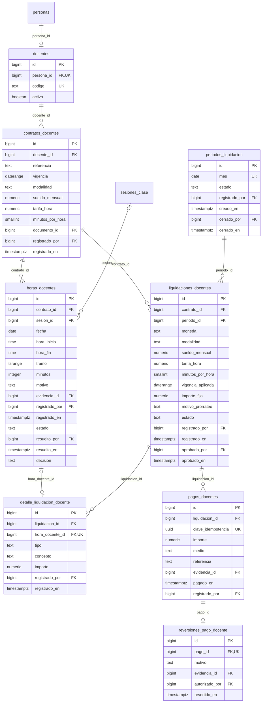

<!-- Archivo generado por scripts/db/generar-docs.mjs a partir del catálogo real. No editar a mano. -->

# Personal docente y planilla

Tablas (8): [`docentes`](#docentes), [`contratos_docentes`](#contratos_docentes), [`horas_docentes`](#horas_docentes), [`periodos_liquidacion`](#periodos_liquidacion), [`liquidaciones_docentes`](#liquidaciones_docentes), [`detalle_liquidacion_docente`](#detalle_liquidacion_docente), [`pagos_docentes`](#pagos_docentes), [`reversiones_pago_docente`](#reversiones_pago_docente).

## Diagrama ER

> Para legibilidad se omiten las referencias de auditoría/evidencia hacia `usuarios` y `archivos` cuando esas tablas no pertenecen al diagrama; sí figuran en el diccionario.

## Diccionario

### docentes

Perfil de docente de una persona: código único y estado activo.

| Columna | Tipo | Nulo | Defecto / generada | Clave / referencia |
|---|---|---|---|---|
| `id` | bigint | no | identity (always) | PK |
| `persona_id` | bigint | no |  | → [`personas`](01-identidad-permisos.md#personas).id · UNIQUE |
| `codigo` | text | no |  | UNIQUE |
| `activo` | boolean | no | `true` |  |

**Restricciones**

- **PK** (id)
- **UNIQUE** (codigo) — `docentes_codigo_key`
- **UNIQUE** (persona_id) — `docentes_persona_id_key`

### contratos_docentes

Contratos fijo (sueldo mensual) o por horas (tarifa y minutos por hora) con vigencia sin solapes.

| Columna | Tipo | Nulo | Defecto / generada | Clave / referencia |
|---|---|---|---|---|
| `id` | bigint | no | identity (always) | PK |
| `docente_id` | bigint | no |  | → [`docentes`](06-personal-planilla.md#docentes).id |
| `referencia` | text | no |  |  |
| `vigencia` | daterange | no |  |  |
| `modalidad` | text | no |  |  |
| `sueldo_mensual` | numeric(12,2) | sí |  |  |
| `tarifa_hora` | numeric(12,4) | sí |  |  |
| `minutos_por_hora` | smallint | sí |  |  |
| `documento_id` | bigint | sí |  | → [`archivos`](07-documentos-reportes.md#archivos).id |
| `registrado_por` | bigint | no |  | → [`usuarios`](01-identidad-permisos.md#usuarios).id |
| `registrado_en` | timestamptz | no | `now()` |  |

**Restricciones**

- **PK** (id)
- **UNIQUE** (docente_id, referencia) — `contratos_docentes_docente_id_referencia_key`
- **CHECK** `contratos_docentes_check`: `((((modalidad = 'fijo') AND (sueldo_mensual IS NOT NULL) AND (sueldo_mensual > (0)) AND (tarifa_hora IS NULL) AND (minutos_por_hora IS NULL)) OR ((modalidad = 'por_horas') AND (sueldo_mensual IS NULL) AND (tarifa_hora IS NOT NULL) AND (tarifa_hora > (0)) AND (minutos_por_hora IS NOT NULL) AND ((minutos_por_hora >= 1) AND (minutos_por_hora <= 60)))))`
- **CHECK** `contratos_docentes_modalidad_check`: `((modalidad = ANY (ARRAY['fijo', 'por_horas'])))`
- **CHECK** `contratos_docentes_referencia_check`: `((btrim(referencia) <> ''))`
- **CHECK** `contratos_docentes_vigencia_check`: `(((NOT isempty(vigencia)) AND (NOT lower_inf(vigencia)) AND (NOT upper_inf(vigencia))))`
- **EXCLUDE** `contratos_docentes_docente_id_vigencia_excl`: `USING gist (docente_id WITH =, vigencia WITH &&)`

**Triggers**

- `controlar_cambio_contrato` — BEFORE UPDATE → [`conservar_condiciones_contrato()`](../funciones.md#conservar_condiciones_contrato)

### horas_docentes

Horas trabajadas en contratos por horas, con aprobación; sin solapes por contrato.

| Columna | Tipo | Nulo | Defecto / generada | Clave / referencia |
|---|---|---|---|---|
| `id` | bigint | no | identity (always) | PK |
| `contrato_id` | bigint | no |  | → [`contratos_docentes`](06-personal-planilla.md#contratos_docentes).id |
| `sesion_id` | bigint | sí |  | → [`sesiones_clase`](03-academico-evaluacion.md#sesiones_clase).id |
| `fecha` | date | no |  |  |
| `hora_inicio` | time | no |  |  |
| `hora_fin` | time | no |  |  |
| `tramo` | tsrange | sí | generada: `tsrange((fecha + hora_inicio), (fecha + hora_fin), '[)')` |  |
| `minutos` | integer | sí | generada: `((EXTRACT(epoch FROM (hora_fin - hora_inicio)) / (60)))` |  |
| `motivo` | text | no |  |  |
| `evidencia_id` | bigint | sí |  | → [`archivos`](07-documentos-reportes.md#archivos).id |
| `registrado_por` | bigint | no |  | → [`usuarios`](01-identidad-permisos.md#usuarios).id |
| `registrado_en` | timestamptz | no | `now()` |  |
| `estado` | text | no | `'pendiente'` |  |
| `resuelto_por` | bigint | sí |  | → [`usuarios`](01-identidad-permisos.md#usuarios).id |
| `resuelto_en` | timestamptz | sí |  |  |
| `decision` | text | sí |  |  |

**Restricciones**

- **PK** (id)
- **CHECK** `horas_docentes_check`: `(((hora_inicio < hora_fin) AND (hora_fin < '24:00:00') AND (EXTRACT(second FROM hora_inicio) = (0)) AND (EXTRACT(second FROM hora_fin) = (0))))`
- **CHECK** `horas_docentes_check1`: `((((estado = 'pendiente') AND (num_nonnulls(resuelto_por, resuelto_en, decision) = 0)) OR ((estado <> 'pendiente') AND (resuelto_por IS NOT NULL) AND (resuelto_en IS NOT NULL) AND (resuelto_en >= registrado_en) AND (decision IS NOT NULL) AND (btrim(decision) <> ''))))`
- **CHECK** `horas_docentes_estado_check`: `((estado = ANY (ARRAY['pendiente', 'aprobada', 'rechazada'])))`
- **CHECK** `horas_docentes_motivo_check`: `((btrim(motivo) <> ''))`
- **EXCLUDE** `horas_docentes_contrato_id_tramo_excl`: `USING gist (contrato_id WITH =, tramo WITH &&) WHERE ((estado <> 'rechazada'))`

**Índices adicionales**

- `horas_docentes_contrato_fecha_idx`: `USING btree (contrato_id, fecha)`

**Triggers**

- `auditar_horas_docentes` — AFTER UPDATE → [`auditar_planilla()`](../funciones.md#auditar_planilla)
- `conservar_horas_docentes` — BEFORE DELETE → [`conservar_historial_planilla()`](../funciones.md#conservar_historial_planilla)
- `controlar_horas_docente` — BEFORE INSERT OR UPDATE → [`validar_horas_docente()`](../funciones.md#validar_horas_docente)

### periodos_liquidacion

Mes de planilla (abierto/cerrado).

| Columna | Tipo | Nulo | Defecto / generada | Clave / referencia |
|---|---|---|---|---|
| `id` | bigint | no | identity (always) | PK |
| `mes` | date | no |  | UNIQUE |
| `estado` | text | no | `'abierto'` |  |
| `registrado_por` | bigint | no |  | → [`usuarios`](01-identidad-permisos.md#usuarios).id |
| `creado_en` | timestamptz | no | `now()` |  |
| `cerrado_por` | bigint | sí |  | → [`usuarios`](01-identidad-permisos.md#usuarios).id |
| `cerrado_en` | timestamptz | sí |  |  |

**Restricciones**

- **PK** (id)
- **UNIQUE** (mes) — `periodos_liquidacion_mes_key`
- **CHECK** `periodos_liquidacion_check`: `(((estado = 'cerrado') = ((cerrado_por IS NOT NULL) AND (cerrado_en IS NOT NULL))))`
- **CHECK** `periodos_liquidacion_check1`: `(((cerrado_por IS NULL) = (cerrado_en IS NULL)))`
- **CHECK** `periodos_liquidacion_check2`: `((cerrado_en >= creado_en))`
- **CHECK** `periodos_liquidacion_estado_check`: `((estado = ANY (ARRAY['abierto', 'cerrado'])))`
- **CHECK** `periodos_liquidacion_mes_check`: `((EXTRACT(day FROM mes) = (1)))`

**Triggers**

- `conservar_periodo_planilla` — BEFORE DELETE → [`conservar_historial_planilla()`](../funciones.md#conservar_historial_planilla)
- `controlar_periodo_planilla` — BEFORE INSERT OR UPDATE → [`controlar_periodo_planilla()`](../funciones.md#controlar_periodo_planilla)

### liquidaciones_docentes

Liquidación mensual por contrato (borrador → aprobada) con condiciones congeladas del contrato.

| Columna | Tipo | Nulo | Defecto / generada | Clave / referencia |
|---|---|---|---|---|
| `id` | bigint | no | identity (always) | PK |
| `contrato_id` | bigint | no |  | → [`contratos_docentes`](06-personal-planilla.md#contratos_docentes).id |
| `periodo_id` | bigint | no |  | → [`periodos_liquidacion`](06-personal-planilla.md#periodos_liquidacion).id |
| `moneda` | text | no | `'PEN'` |  |
| `modalidad` | text | no |  |  |
| `sueldo_mensual` | numeric(12,2) | sí |  |  |
| `tarifa_hora` | numeric(12,4) | sí |  |  |
| `minutos_por_hora` | smallint | sí |  |  |
| `vigencia_aplicada` | daterange | no |  |  |
| `importe_fijo` | numeric(12,2) | sí |  |  |
| `motivo_prorrateo` | text | sí |  |  |
| `estado` | text | no | `'borrador'` |  |
| `registrado_por` | bigint | no |  | → [`usuarios`](01-identidad-permisos.md#usuarios).id |
| `registrado_en` | timestamptz | no | `now()` |  |
| `aprobado_por` | bigint | sí |  | → [`usuarios`](01-identidad-permisos.md#usuarios).id |
| `aprobado_en` | timestamptz | sí |  |  |

**Restricciones**

- **PK** (id)
- **UNIQUE** (contrato_id, periodo_id) — `liquidaciones_docentes_contrato_id_periodo_id_key`
- **CHECK** `liquidaciones_docentes_check`: `(((estado = 'aprobada') = ((aprobado_por IS NOT NULL) AND (aprobado_en IS NOT NULL))))`
- **CHECK** `liquidaciones_docentes_check1`: `(((aprobado_por IS NULL) = (aprobado_en IS NULL)))`
- **CHECK** `liquidaciones_docentes_check2`: `((aprobado_en >= registrado_en))`
- **CHECK** `liquidaciones_docentes_check3`: `((((modalidad = 'fijo') AND (sueldo_mensual IS NOT NULL) AND (importe_fijo IS NOT NULL) AND ((importe_fijo >= (0)) AND (importe_fijo <= sueldo_mensual)) AND (tarifa_hora IS NULL) AND (minutos_por_hora IS NULL)) OR ((modalidad = 'por_horas') AND (sueldo_mensual IS NULL) AND (importe_fijo IS NULL) AND (motivo_prorrateo IS NULL) AND (tarifa_hora IS NOT NULL) AND (minutos_por_hora IS NOT NULL))))`
- **CHECK** `liquidaciones_docentes_estado_check`: `((estado = ANY (ARRAY['borrador', 'aprobada'])))`
- **CHECK** `liquidaciones_docentes_modalidad_check`: `((modalidad = ANY (ARRAY['fijo', 'por_horas'])))`
- **CHECK** `liquidaciones_docentes_moneda_check`: `((moneda = 'PEN'))`
- **CHECK** `liquidaciones_docentes_vigencia_aplicada_check`: `((NOT isempty(vigencia_aplicada)))`

**Triggers**

- `auditar_liquidacion_docente` — AFTER UPDATE WHEN `(old.estado IS DISTINCT FROM new.estado)` → [`auditar_planilla()`](../funciones.md#auditar_planilla)
- `conservar_liquidacion_aprobada` — BEFORE DELETE WHEN `(old.estado = 'aprobada'::text)` → [`conservar_historial_planilla()`](../funciones.md#conservar_historial_planilla)
- `controlar_liquidacion_docente` — BEFORE INSERT OR UPDATE → [`validar_liquidacion_docente()`](../funciones.md#validar_liquidacion_docente)

### detalle_liquidacion_docente

Líneas de la liquidación: horas, adicionales y descuentos.

| Columna | Tipo | Nulo | Defecto / generada | Clave / referencia |
|---|---|---|---|---|
| `id` | bigint | no | identity (always) | PK |
| `liquidacion_id` | bigint | no |  | → [`liquidaciones_docentes`](06-personal-planilla.md#liquidaciones_docentes).id |
| `hora_docente_id` | bigint | sí |  | → [`horas_docentes`](06-personal-planilla.md#horas_docentes).id · UNIQUE |
| `tipo` | text | no |  |  |
| `concepto` | text | no |  |  |
| `importe` | numeric(12,2) | sí |  |  |
| `registrado_por` | bigint | no |  | → [`usuarios`](01-identidad-permisos.md#usuarios).id |
| `registrado_en` | timestamptz | no | `now()` |  |

**Restricciones**

- **PK** (id)
- **UNIQUE** (hora_docente_id) — `detalle_liquidacion_docente_hora_docente_id_key`
- **CHECK** `detalle_liquidacion_docente_check`: `((((tipo = 'horas') AND (hora_docente_id IS NOT NULL) AND (importe IS NULL)) OR ((tipo <> 'horas') AND (hora_docente_id IS NULL) AND (importe IS NOT NULL) AND (importe > (0)))))`
- **CHECK** `detalle_liquidacion_docente_concepto_check`: `((btrim(concepto) <> ''))`
- **CHECK** `detalle_liquidacion_docente_tipo_check`: `((tipo = ANY (ARRAY['horas', 'adicional', 'descuento'])))`

**Índices adicionales**

- `detalle_liquidacion_docente_liq_idx`: `USING btree (liquidacion_id)`

**Triggers**

- `controlar_detalle_liquidacion` — BEFORE INSERT OR DELETE OR UPDATE → [`validar_detalle_liquidacion()`](../funciones.md#validar_detalle_liquidacion)

### pagos_docentes

Pagos de liquidaciones aprobadas, idempotentes; no exceden el saldo.

| Columna | Tipo | Nulo | Defecto / generada | Clave / referencia |
|---|---|---|---|---|
| `id` | bigint | no | identity (always) | PK |
| `liquidacion_id` | bigint | no |  | → [`liquidaciones_docentes`](06-personal-planilla.md#liquidaciones_docentes).id |
| `clave_idempotencia` | uuid | no |  | UNIQUE |
| `importe` | numeric(12,2) | no |  |  |
| `medio` | text | no |  |  |
| `referencia` | text | sí |  |  |
| `evidencia_id` | bigint | sí |  | → [`archivos`](07-documentos-reportes.md#archivos).id |
| `pagado_en` | timestamptz | no | `clock_timestamp()` |  |
| `registrado_por` | bigint | no |  | → [`usuarios`](01-identidad-permisos.md#usuarios).id |

**Restricciones**

- **PK** (id)
- **UNIQUE** (clave_idempotencia) — `pagos_docentes_clave_idempotencia_key`
- **CHECK** `pagos_docentes_importe_check`: `((importe > (0)))`
- **CHECK** `pagos_docentes_medio_check`: `((medio = ANY (ARRAY['transferencia', 'efectivo', 'otro'])))`

**Índices adicionales**

- `pagos_docentes_liq_idx`: `USING btree (liquidacion_id)`

**Triggers**

- `auditar_pago_docente` — AFTER INSERT → [`auditar_planilla()`](../funciones.md#auditar_planilla)
- `conservar_pago_docente` — BEFORE DELETE OR UPDATE → [`conservar_historial_planilla()`](../funciones.md#conservar_historial_planilla)
- `controlar_pago_docente` — BEFORE INSERT → [`validar_movimiento_pago_docente()`](../funciones.md#validar_movimiento_pago_docente)

### reversiones_pago_docente

Reversión de un pago docente (una por pago).

| Columna | Tipo | Nulo | Defecto / generada | Clave / referencia |
|---|---|---|---|---|
| `id` | bigint | no | identity (always) | PK |
| `pago_id` | bigint | no |  | → [`pagos_docentes`](06-personal-planilla.md#pagos_docentes).id · UNIQUE |
| `motivo` | text | no |  |  |
| `evidencia_id` | bigint | sí |  | → [`archivos`](07-documentos-reportes.md#archivos).id |
| `autorizado_por` | bigint | no |  | → [`usuarios`](01-identidad-permisos.md#usuarios).id |
| `revertido_en` | timestamptz | no | `clock_timestamp()` |  |

**Restricciones**

- **PK** (id)
- **UNIQUE** (pago_id) — `reversiones_pago_docente_pago_id_key`
- **CHECK** `reversiones_pago_docente_motivo_check`: `((btrim(motivo) <> ''))`

**Triggers**

- `auditar_reversion_docente` — AFTER INSERT → [`auditar_planilla()`](../funciones.md#auditar_planilla)
- `conservar_reversion_docente` — BEFORE DELETE OR UPDATE → [`conservar_historial_planilla()`](../funciones.md#conservar_historial_planilla)
- `controlar_reversion_docente` — BEFORE INSERT → [`validar_movimiento_pago_docente()`](../funciones.md#validar_movimiento_pago_docente)
