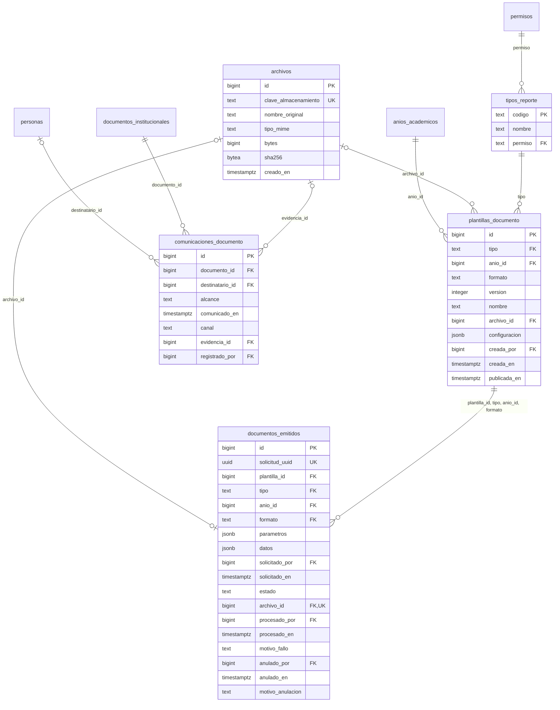

<!-- Archivo generado por scripts/db/generar-docs.mjs a partir del catálogo real. No editar a mano. -->

# Documentos, archivos y reportes

Tablas (5): [`archivos`](#archivos), [`tipos_reporte`](#tipos_reporte), [`plantillas_documento`](#plantillas_documento), [`documentos_emitidos`](#documentos_emitidos), [`comunicaciones_documento`](#comunicaciones_documento).

## Diagrama ER

> Para legibilidad se omiten las referencias de auditoría/evidencia hacia `usuarios` y `archivos` cuando esas tablas no pertenecen al diagrama; sí figuran en el diccionario.

## Diccionario

### archivos

Metadatos de archivos guardados fuera de la base (clave de almacenamiento, MIME, bytes, SHA-256). Evidencia transversal.

| Columna | Tipo | Nulo | Defecto / generada | Clave / referencia |
|---|---|---|---|---|
| `id` | bigint | no | identity (always) | PK |
| `clave_almacenamiento` | text | no |  | UNIQUE |
| `nombre_original` | text | no |  |  |
| `tipo_mime` | text | no |  |  |
| `bytes` | bigint | no |  |  |
| `sha256` | bytea | no |  |  |
| `creado_en` | timestamptz | no | `now()` |  |

**Restricciones**

- **PK** (id)
- **UNIQUE** (clave_almacenamiento) — `archivos_clave_almacenamiento_key`
- **CHECK** `archivos_bytes_check`: `((bytes >= 0))`
- **CHECK** `archivos_sha256_check`: `((octet_length(sha256) = 32))`

### tipos_reporte

Tipos de reporte y permiso requerido para emitirlos.

Filas sembradas en el dump: **7**.

| Columna | Tipo | Nulo | Defecto / generada | Clave / referencia |
|---|---|---|---|---|
| `codigo` | text | no |  | PK |
| `nombre` | text | no |  |  |
| `permiso` | text | no |  | → [`permisos`](01-identidad-permisos.md#permisos).codigo |

**Restricciones**

- **PK** (codigo)

### plantillas_documento

Plantillas versionadas por tipo, año y formato (pdf/xlsx). Inmutables al publicarse.

| Columna | Tipo | Nulo | Defecto / generada | Clave / referencia |
|---|---|---|---|---|
| `id` | bigint | no | identity (always) | PK |
| `tipo` | text | no |  | → [`tipos_reporte`](07-documentos-reportes.md#tipos_reporte).codigo |
| `anio_id` | bigint | no |  | → [`anios_academicos`](03-academico-evaluacion.md#anios_academicos).id |
| `formato` | text | no |  |  |
| `version` | integer | no |  |  |
| `nombre` | text | no |  |  |
| `archivo_id` | bigint | sí |  | → [`archivos`](07-documentos-reportes.md#archivos).id |
| `configuracion` | jsonb | no | `'{}'::jsonb` |  |
| `creada_por` | bigint | no |  | → [`usuarios`](01-identidad-permisos.md#usuarios).id |
| `creada_en` | timestamptz | no | `clock_timestamp()` |  |
| `publicada_en` | timestamptz | sí |  |  |

**Restricciones**

- **PK** (id)
- **UNIQUE** (id, tipo, anio_id, formato) — `plantillas_documento_id_tipo_anio_id_formato_key`
- **UNIQUE** (tipo, anio_id, formato, version) — `plantillas_documento_tipo_anio_id_formato_version_key`
- **CHECK** `plantillas_documento_check`: `((publicada_en >= creada_en))`
- **CHECK** `plantillas_documento_configuracion_check`: `((jsonb_typeof(configuracion) = 'object'))`
- **CHECK** `plantillas_documento_formato_check`: `((formato = ANY (ARRAY['pdf', 'xlsx'])))`
- **CHECK** `plantillas_documento_nombre_check`: `((btrim(nombre) <> ''))`
- **CHECK** `plantillas_documento_version_check`: `((version > 0))`

**Triggers**

- `proteger_plantilla_publicada` — BEFORE DELETE OR UPDATE → [`proteger_documento_reporte()`](../funciones.md#proteger_documento_reporte)

### documentos_emitidos

Solicitudes de documento (cola): preparado → emitido/fallido; emitido → anulado. Datos congelados en jsonb.

| Columna | Tipo | Nulo | Defecto / generada | Clave / referencia |
|---|---|---|---|---|
| `id` | bigint | no | identity (always) | PK |
| `solicitud_uuid` | uuid | no |  | UNIQUE |
| `plantilla_id` | bigint | no |  | → [`plantillas_documento`](07-documentos-reportes.md#plantillas_documento) (FK compuesta) |
| `tipo` | text | no |  | → [`plantillas_documento`](07-documentos-reportes.md#plantillas_documento) (FK compuesta) |
| `anio_id` | bigint | no |  | → [`plantillas_documento`](07-documentos-reportes.md#plantillas_documento) (FK compuesta) |
| `formato` | text | no |  | → [`plantillas_documento`](07-documentos-reportes.md#plantillas_documento) (FK compuesta) |
| `parametros` | jsonb | no |  |  |
| `datos` | jsonb | no |  |  |
| `solicitado_por` | bigint | no |  | → [`usuarios`](01-identidad-permisos.md#usuarios).id |
| `solicitado_en` | timestamptz | no | `clock_timestamp()` |  |
| `estado` | text | no | `'preparado'` |  |
| `archivo_id` | bigint | sí |  | → [`archivos`](07-documentos-reportes.md#archivos).id · UNIQUE |
| `procesado_por` | bigint | sí |  | → [`usuarios`](01-identidad-permisos.md#usuarios).id |
| `procesado_en` | timestamptz | sí |  |  |
| `motivo_fallo` | text | sí |  |  |
| `anulado_por` | bigint | sí |  | → [`usuarios`](01-identidad-permisos.md#usuarios).id |
| `anulado_en` | timestamptz | sí |  |  |
| `motivo_anulacion` | text | sí |  |  |

**Restricciones**

- **PK** (id)
- **UNIQUE** (archivo_id) — `documentos_emitidos_archivo_id_key`
- **UNIQUE** (solicitud_uuid) — `documentos_emitidos_solicitud_uuid_key`
- **FK** (plantilla_id, tipo, anio_id, formato) → [`plantillas_documento`](07-documentos-reportes.md#plantillas_documento) (id, tipo, anio_id, formato)
- **CHECK** `documentos_emitidos_check`: `((procesado_en >= solicitado_en))`
- **CHECK** `documentos_emitidos_check1`: `((anulado_en >= procesado_en))`
- **CHECK** `documentos_emitidos_check2`: `((((estado = 'preparado') AND (num_nonnulls(archivo_id, procesado_por, procesado_en, motivo_fallo) = 0)) OR ((estado = ANY (ARRAY['emitido', 'anulado'])) AND (num_nonnulls(archivo_id, procesado_por, procesado_en) = 3) AND (motivo_fallo IS NULL)) OR ((estado = 'fallido') AND (archivo_id IS NULL) AND (procesado_por IS NOT NULL) AND (procesado_en IS NOT NULL) AND (motivo_fallo IS NOT NULL) AND (btrim(motivo_fallo) <> ''))))`
- **CHECK** `documentos_emitidos_check3`: `((((estado <> 'anulado') AND (num_nonnulls(anulado_por, anulado_en, motivo_anulacion) = 0)) OR ((estado = 'anulado') AND (anulado_por IS NOT NULL) AND (anulado_en IS NOT NULL) AND (motivo_anulacion IS NOT NULL) AND (btrim(motivo_anulacion) <> ''))))`
- **CHECK** `documentos_emitidos_datos_check`: `((jsonb_typeof(datos) = 'object'))`
- **CHECK** `documentos_emitidos_estado_check`: `((estado = ANY (ARRAY['preparado', 'emitido', 'fallido', 'anulado'])))`
- **CHECK** `documentos_emitidos_parametros_check`: `((jsonb_typeof(parametros) = 'object'))`

**Índices adicionales**

- `documentos_emitidos_cola_idx`: `USING btree (id) WHERE (estado = 'preparado')`
- `documentos_emitidos_consulta_idx`: `USING btree (anio_id, tipo, solicitado_en DESC)`

**Triggers**

- `auditar_documento_reporte` — AFTER INSERT OR UPDATE → [`auditar_documento_reporte()`](../funciones.md#auditar_documento_reporte)
- `proteger_documento_emitido` — BEFORE INSERT OR DELETE OR UPDATE → [`proteger_documento_reporte()`](../funciones.md#proteger_documento_reporte)

### comunicaciones_documento

Registro de comunicación/entrega de documentos institucionales a una persona o a un alcance.

| Columna | Tipo | Nulo | Defecto / generada | Clave / referencia |
|---|---|---|---|---|
| `id` | bigint | no | identity (always) | PK |
| `documento_id` | bigint | no |  | → [`documentos_institucionales`](02-matricula.md#documentos_institucionales).id |
| `destinatario_id` | bigint | sí |  | → [`personas`](01-identidad-permisos.md#personas).id |
| `alcance` | text | sí |  |  |
| `comunicado_en` | timestamptz | no |  |  |
| `canal` | text | no |  |  |
| `evidencia_id` | bigint | sí |  | → [`archivos`](07-documentos-reportes.md#archivos).id |
| `registrado_por` | bigint | no |  | → [`usuarios`](01-identidad-permisos.md#usuarios).id |

**Restricciones**

- **PK** (id)
- **CHECK** `comunicaciones_documento_check`: `(((destinatario_id IS NOT NULL) OR (NULLIF(btrim(alcance), '') IS NOT NULL)))`
