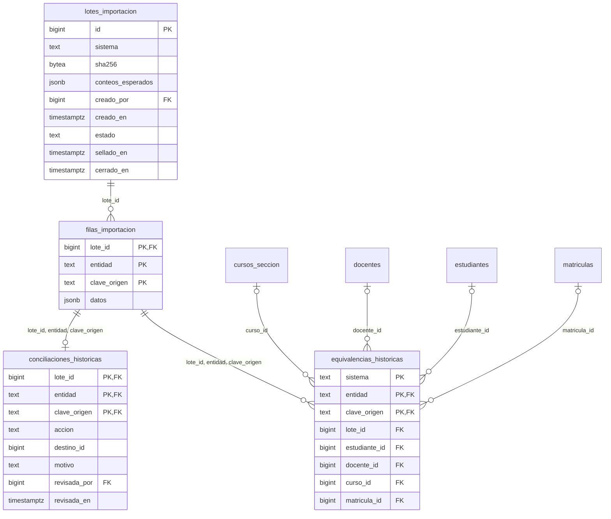

<!-- Archivo generado por scripts/db/generar-docs.mjs a partir del catálogo real. No editar a mano. -->

# Importación histórica

Tablas (4): [`lotes_importacion`](#lotes_importacion), [`filas_importacion`](#filas_importacion), [`conciliaciones_historicas`](#conciliaciones_historicas), [`equivalencias_historicas`](#equivalencias_historicas).

## Diagrama ER

> Para legibilidad se omiten las referencias de auditoría/evidencia hacia `usuarios` y `archivos` cuando esas tablas no pertenecen al diagrama; sí figuran en el diccionario.

## Diccionario

### lotes_importacion

Lote de datos de un sistema anterior (hash y conteos esperados): carga → revisión → cerrado.

| Columna | Tipo | Nulo | Defecto / generada | Clave / referencia |
|---|---|---|---|---|
| `id` | bigint | no | identity (always) | PK |
| `sistema` | text | no |  |  |
| `sha256` | bytea | no |  |  |
| `conteos_esperados` | jsonb | no |  |  |
| `creado_por` | bigint | no |  | → [`usuarios`](01-identidad-permisos.md#usuarios).id |
| `creado_en` | timestamptz | no | `clock_timestamp()` |  |
| `estado` | text | no | `'carga'` |  |
| `sellado_en` | timestamptz | sí |  |  |
| `cerrado_en` | timestamptz | sí |  |  |

**Restricciones**

- **PK** (id)
- **UNIQUE** (sistema, sha256) — `lotes_importacion_sistema_sha256_key`
- **CHECK** `lotes_importacion_check`: `((((estado = 'carga') AND (sellado_en IS NULL) AND (cerrado_en IS NULL)) OR ((estado = 'revision') AND (sellado_en IS NOT NULL) AND (cerrado_en IS NULL)) OR ((estado = 'cerrado') AND (sellado_en IS NOT NULL) AND (cerrado_en IS NOT NULL))))`
- **CHECK** `lotes_importacion_conteos_esperados_check`: `((jsonb_typeof(conteos_esperados) = 'object'))`
- **CHECK** `lotes_importacion_estado_check`: `((estado = ANY (ARRAY['carga', 'revision', 'cerrado'])))`
- **CHECK** `lotes_importacion_sha256_check`: `((octet_length(sha256) = 32))`
- **CHECK** `lotes_importacion_sistema_check`: `(((sistema = lower(btrim(sistema))) AND (sistema <> '')))`

### filas_importacion

Filas crudas (jsonb plano, sin credenciales). Solo inserción durante la carga.

| Columna | Tipo | Nulo | Defecto / generada | Clave / referencia |
|---|---|---|---|---|
| `lote_id` | bigint | no |  | PK · → [`lotes_importacion`](08-importacion-historica.md#lotes_importacion).id |
| `entidad` | text | no |  | PK |
| `clave_origen` | text | no |  | PK |
| `datos` | jsonb | no |  |  |

**Restricciones**

- **PK** (lote_id, entidad, clave_origen)
- **CHECK** `filas_importacion_clave_origen_check`: `((btrim(clave_origen) <> ''))`
- **CHECK** `filas_importacion_datos_check`: `(((jsonb_typeof(datos) = 'object') AND (datos <> '{}'::jsonb)))`
- **CHECK** `filas_importacion_entidad_check`: `((entidad = ANY (ARRAY['estudiantes', 'profesores', 'cursos', 'estudiantes_cursos', 'notas_bimestre', 'entradas_notas', 'reportes_notas', 'materias_reportes_notas', 'puntuaciones_notas', 'valores_puntuaciones_notas', 'registros_asistencia', 'comentarios_estudiantes'])))`

**Triggers**

- `controlar_fila_importacion` — BEFORE INSERT OR DELETE OR UPDATE → [`controlar_carga_historica()`](../funciones.md#controlar_carga_historica)

### conciliaciones_historicas

Decisión por fila: crear, vincular, archivar o excluir. Inmutable.

| Columna | Tipo | Nulo | Defecto / generada | Clave / referencia |
|---|---|---|---|---|
| `lote_id` | bigint | no |  | PK · → [`filas_importacion`](08-importacion-historica.md#filas_importacion) (FK compuesta) |
| `entidad` | text | no |  | PK · → [`filas_importacion`](08-importacion-historica.md#filas_importacion) (FK compuesta) |
| `clave_origen` | text | no |  | PK · → [`filas_importacion`](08-importacion-historica.md#filas_importacion) (FK compuesta) |
| `accion` | text | no |  |  |
| `destino_id` | bigint | sí |  |  |
| `motivo` | text | no |  |  |
| `revisada_por` | bigint | no |  | → [`usuarios`](01-identidad-permisos.md#usuarios).id |
| `revisada_en` | timestamptz | no | `clock_timestamp()` |  |

**Restricciones**

- **PK** (lote_id, entidad, clave_origen)
- **FK** (lote_id, entidad, clave_origen) → [`filas_importacion`](08-importacion-historica.md#filas_importacion) (lote_id, entidad, clave_origen)
- **CHECK** `conciliaciones_historicas_accion_check`: `((accion = ANY (ARRAY['crear', 'vincular', 'archivar', 'excluir'])))`
- **CHECK** `conciliaciones_historicas_check`: `(((accion = ANY (ARRAY['crear', 'vincular'])) = (destino_id IS NOT NULL)))`
- **CHECK** `conciliaciones_historicas_motivo_check`: `((btrim(motivo) <> ''))`

**Triggers**

- `conservar_conciliacion` — BEFORE DELETE OR UPDATE → [`conservar_evento_asistencia()`](../funciones.md#conservar_evento_asistencia)

### equivalencias_historicas

Equivalencia clave de origen → registro actual (alumno, docente, curso, matrícula). Inmutable.

| Columna | Tipo | Nulo | Defecto / generada | Clave / referencia |
|---|---|---|---|---|
| `sistema` | text | no |  | PK |
| `entidad` | text | no |  | PK · → [`filas_importacion`](08-importacion-historica.md#filas_importacion) (FK compuesta) |
| `clave_origen` | text | no |  | PK · → [`filas_importacion`](08-importacion-historica.md#filas_importacion) (FK compuesta) |
| `lote_id` | bigint | no |  | → [`filas_importacion`](08-importacion-historica.md#filas_importacion) (FK compuesta) |
| `estudiante_id` | bigint | sí |  | → [`estudiantes`](02-matricula.md#estudiantes).id |
| `docente_id` | bigint | sí |  | → [`docentes`](06-personal-planilla.md#docentes).id |
| `curso_id` | bigint | sí |  | → [`cursos_seccion`](03-academico-evaluacion.md#cursos_seccion).id |
| `matricula_id` | bigint | sí |  | → [`matriculas`](02-matricula.md#matriculas).id |

**Restricciones**

- **PK** (sistema, entidad, clave_origen)
- **FK** (lote_id, entidad, clave_origen) → [`filas_importacion`](08-importacion-historica.md#filas_importacion) (lote_id, entidad, clave_origen)
- **CHECK** `equivalencias_historicas_check`: `((num_nonnulls(estudiante_id, docente_id, curso_id, matricula_id) = 1))`
- **CHECK** `equivalencias_historicas_check1`: `((((entidad = 'estudiantes') AND (estudiante_id IS NOT NULL)) OR ((entidad = 'profesores') AND (docente_id IS NOT NULL)) OR ((entidad = 'cursos') AND (curso_id IS NOT NULL)) OR ((entidad = 'estudiantes_cursos') AND (matricula_id IS NOT NULL))))`

**Triggers**

- `conservar_equivalencia` — BEFORE DELETE OR UPDATE → [`conservar_evento_asistencia()`](../funciones.md#conservar_evento_asistencia)
